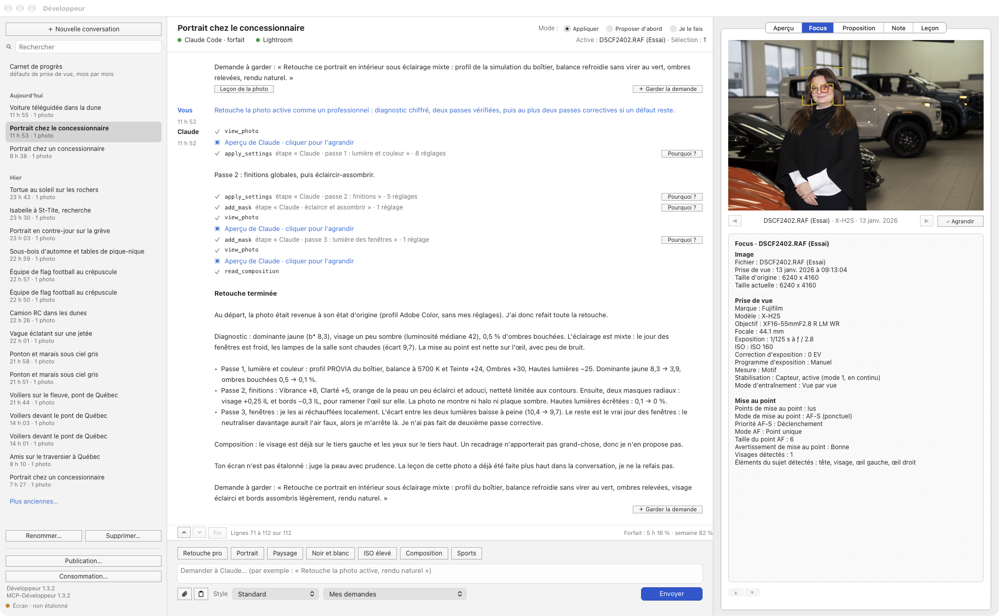
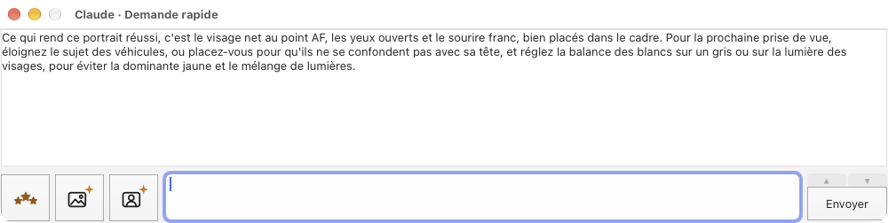
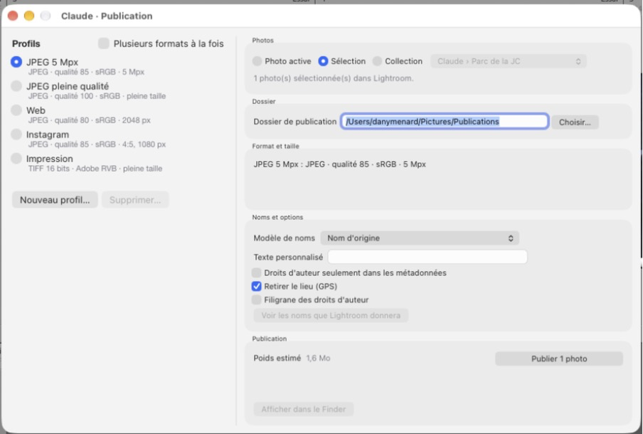
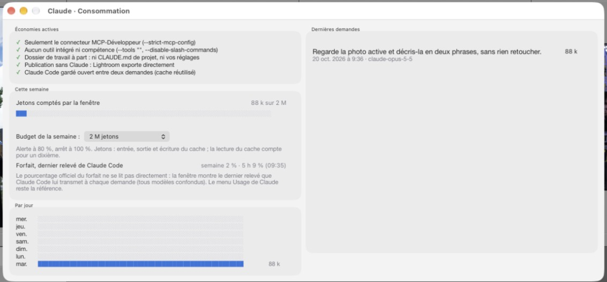
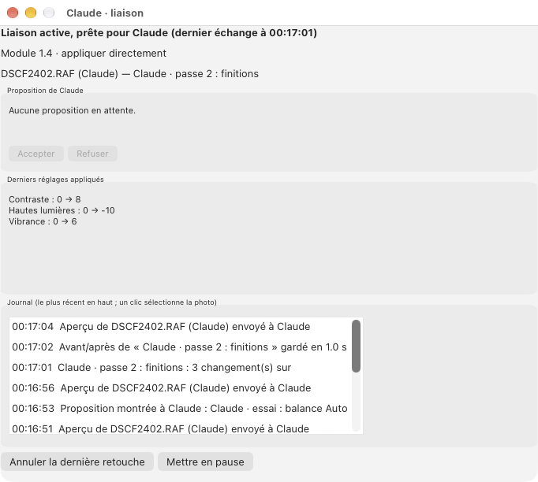

# Développeur

Développeur relie Claude à Lightroom Classic sur Mac : vous écrivez à Claude dans une fenêtre de
Lightroom (ou dans Claude Desktop ou Claude Code), et il regarde vos photos, les mesure et les
retouche avec la méthode d'un retoucheur professionnel, en vous disant ce qu'il change et pourquoi.
Il note aussi vos photos selon un standard clair : il propose une note, que vous acceptez ou
changez dans Lightroom, ou il la pose lui-même si vous le lui demandez. Chaque photo a sa
conversation, qui s'ouvre sur ce que Claude y a déjà fait. Pour vous faire progresser, il dit
pourquoi il fait chaque étape, lit la composition et tient un carnet de progrès de vos prises de
vue ; la fenêtre Suivi montre en graphiques vos prises de vue et ce carnet, chaque photo ouverte y
étant analysée d'office sur le Mac, sans Claude. Il est fait pour le
photographe amateur qui veut des photos d'allure professionnelle sans être un pro. Deux pièces : le
connecteur MCP-Développeur, un serveur MCP (*Model Context Protocol*) écrit en Swift, et le module
« Développeur » de Lightroom Classic, qui exécute ses demandes et porte la fenêtre Claude.




## Fonctions

### La fenêtre Claude dans Lightroom

- Une fenêtre flottante de 1 623 × 1 200 points, « Développeur v1.4 » dans sa barre de titre
  (la version du module installé) : Fichier ›
  Module externe - Extras › Ouvrir la fenêtre Claude (même entrée dans le menu Bibliothèque, et
  raccourci ⌃⌥C une fois posé). Elle reste ouverte pendant que vous travaillez, dans tous les
  modules de Lightroom, et laisse environ 1 815 points à Lightroom sur un écran de 3 440 × 1 440.
  Son allure est celle de la maquette « B · Conversation claire », agrandie à votre demande, sans
  le volet des conversations de gauche depuis le correctif 1.3.6.
- Le modèle, l'effort, l'apparence et deux cases se règlent dans Fichier › Gestionnaire de
  modules externes › Développeur, section Fenêtre Claude, et non dans la fenêtre :
  - Modèle : Fable (le plus capable), Opus (retouche fine, par défaut), Sonnet (courant) ou Haiku
    (rapide).
  - Effort : maximal (par défaut), très élevé, élevé, moyen ou faible, le même pour les quatre
    modèles. Plus d'effort, c'est une réponse plus soignée, mais plus lente et qui compte davantage
    dans le forfait. Un autre modèle ou un autre effort vaut pour la demande suivante, dans la même
    conversation.
  - Apparence : claire (par défaut) ou sombre, à l'ouverture suivante de la fenêtre. Elle règle les
    fonds, les textes et les images de la fenêtre ; les boutons, les champs et les menus suivent
    l'apparence de macOS.
  - Autre photo, cochée par défaut, « Reprendre sa conversation, sinon une nouvelle » : la photo que
    vous choisissez dans Lightroom montre sa conversation (voir plus bas), et une demande rapide
    sur une seule photo écrit dans la sienne. Décochée, la conversation montrée reste, quelle que
    soit la sélection, et chaque demande rapide part dans une conversation jamais gardée.
  - Avant/après, cochée par défaut : l'avant/après de chaque étape de Claude, montré d'un clic sur
    l'étape (voir Apprendre avec Claude).

  Le mode, Appliquer directement ou Proposer d'abord, se règle dans la section Liaison avec Claude
  du même Gestionnaire (« Avant d'appliquer ») : la fenêtre suit ce réglage, et l'infobulle de son
  voyant Lightroom le rappelle (la rangée Mode de l'en-tête est retirée au correctif 1.3.6).
- Deux colonnes :
  - au centre, l'en-tête (le titre de la conversation et, à sa droite, quatre petits boutons côte à
    côte : « Repartir à neuf », Suivi, Publication… et Consommation… ; dessous, les voyants Claude
    Code et Lightroom, la photo active et le nombre de photos sélectionnées), le
    fil, ▲ ▼ Fin, puis la saisie : les invites, le champ de demande, 📎, 📋, « Style » et son menu,
    Mes demandes, le bandeau des messages et Envoyer ;
  - à droite, les onglets Focus (montré à l'ouverture), Note, Aperçu et Proposition, l'aperçu
    commun aux quatre (◀ légende ▶ et ⤢ Agrandir dessous), puis la carte de l'onglet choisi.

  Publication… et Consommation… s'ouvrent aussi par Fichier › Module externe - Extras, la fenêtre
  principale de Lightroom devant (quand une fenêtre du module est devant, Lightroom réduit son
  menu Fichier).
- Claude y travaille par Claude Code et votre forfait claude.ai, avec les seuls outils du
  connecteur : ni fichiers, ni terminal, ni web.
- Une photo, une conversation (correctif 1.3.6) : quand vous choisissez une seule photo dans
  Lightroom, la fenêtre montre sa conversation, telle que vous l'avez laissée, et Claude reprend sa
  session (ce qui s'y est dit et fait). Chaque copie virtuelle a la sienne. Une photo choisie
  pendant que la fenêtre est fermée compte aussi, à la réouverture.
  - Une photo qui n'a pas encore de conversation en commence une, avec l'historique de la photo
    (depuis le correctif 1.3.8, il ne s'affiche plus dans le fil : le résumé de la photo, en haut du
    fil, dit déjà où elle en est ; Claude le reçoit toujours avec votre première demande) : ses étapes de Claude avec leur raison et leur date (les huit dernières,
    faites dans la fenêtre, par la Demande rapide ou par Claude Desktop), et ce que vous avez repris
    à la main depuis la dernière (« Exposition 0,45 → 0,6 ») ; « retouchée à la main, sans étape de
    Claude » pour une photo que vous seul avez développée, avec ses réglages qui s'écartent de leur
    valeur par défaut (« Réglages hors des valeurs par défaut : Profil Camera CLASSIC CHROME ·
    Balance 5 600 K / +8 · Exposition +0,45 · Ombres +30 · Recadrée · 2 masques »), que Claude
    reçoit aussi ; rien pour une photo jamais touchée.
    Elle n'est gardée sur le disque qu'à votre première demande : parcourir des centaines de
    photos ne crée aucun fichier.
  - Quand vous revenez à une photo qui a changé depuis que sa conversation l'a vue (une étape de
    Claude faite ailleurs, une reprise à la main), une ligne « Depuis la dernière fois » dit ce qui
    a changé ; rien de changé, rien d'ajouté.
  - L'historique, « Depuis la dernière fois » et le résumé d'un groupe sont faits par la fenêtre,
    sans Claude ni forfait, et partent avec votre demande suivante, une seule fois : Claude sait
    d'où il repart. Lightroom ne laisse pas lire son panneau Historique : l'historique, c'est le
    journal de Claude et vos reprises à la main.
  - Plusieurs photos sélectionnées : une conversation de groupe, le temps du travail, jamais
    gardée, qui commence par un résumé court pour Claude (« 3 de ces 12 photos ont déjà des étapes
    de Claude : DSCF4961.RAF, … » ; plus affiché dans le fil depuis le correctif 1.3.8 : le résumé de
    la sélection le redit). Changer de photo active dans la même sélection ne change pas de
    conversation. Ce que Claude y fait arrive dans le journal de chaque photo, que sa conversation
    lira ensuite.
  - Rien ne change pendant que Claude travaille : ce qu'il change lui-même (une photo qu'il montre,
    un tri), pendant son travail et dans les 4 secondes qui suivent, reste dans la conversation,
    même fenêtre fermée : rouverte, elle retrouve la conversation où Claude travaillait.
  - « Repartir à neuf », à droite du titre : une conversation neuve pour la photo, avec son
    historique. L'ancienne reste sur le disque, mise de côté : elle ne revient plus, et elle n'est
    jamais effacée. Grisé pendant que Claude travaille, sans photo seule, et quand la conversation
    montrée n'est pas celle de la photo active (case Autre photo décochée, par exemple).
- Le titre : le nom de la photo (« DSCF4961.RAF (Copie 2) »), ou « 12 photos » pour un groupe,
  jusqu'à celui que Claude donne d'après ce qu'il voit sur la photo (« Flamant rose au bord de
  l'eau ») ; il ne se renomme pas. Une conversation commencée par la Demande rapide reçoit le sien à
  la première demande faite dans la fenêtre.
- Le fil, sur 42 lignes : chaque tour marqué « Vous » ou « Claude », avec son heure ; vos
  demandes, les réponses de Claude (titres et listes mis en forme), chaque appel d'outil sur une
  ligne, son nom en Menlo (✓ fait, ● en cours, ✕ erreur), et les notes de Claude (« Notes
  proposées · passe 2 · 14 photos », puis une ligne par photo, « à vérifier » quand Claude doute) ;
  quand vous lui avez demandé de les poser : « Notes à poser » pendant l'appel, puis « Notes
  posées » (« posée » sur chaque ligne), ou « Notes non posées » si aucune ne l'a été (liaison en
  pause, accord attendu : la raison est sur chaque ligne). « Depuis la dernière fois » est en gris,
  sans « Vous » ni « Claude » ; une demande faite par la Demande
  rapide porte dessous la mention « Demande rapide ». Le tour de Claude qui a noté finit par
  « ☆ Voir la note ».
  Un clic sur une étape de Claude ouvre l'onglet Aperçu : son avant/après et sa raison (voir
  Apprendre avec Claude). Un clic sur une image (« Aperçu de Claude · cliquer pour le voir, avec son
  pourquoi ») l'ouvre aussi, sur cette image, avec le pourquoi de l'étape qui la précède ; l'image
  de la proposition qui attend votre accord s'ouvre dans l'onglet Proposition, et une photo jointe
  n'a pas de pourquoi. Un clic sur un outil montre ce que Claude a demandé au connecteur et sa
  réponse. ▲, ▼ et Fin pour
  s'y déplacer ; à droite, ce que fait Claude, sinon le dernier relevé du forfait (5 heures et
  semaine).
- En haut du fil, toujours, le résumé que fait la fenêtre (sans Claude ni forfait), en gris : en
  tête du fil, au-dessus de votre première demande (« Vous ») ; « Depuis la dernière fois » reste à
  sa place, plus bas. Il se fait à l'ouverture de la fenêtre, et chaque fois qu'une autre photo ou une
  autre sélection change la conversation montrée ; le fil, lui, s'ouvre toujours sur son bas (la
  dernière réponse). Pour une photo, « Résumé de la photo : … » : sa prise de vue (appareil,
  objectif, focale, ouverture, vitesse, ISO, date, comme Lightroom les écrit), sa note et son drapeau
  (« 3 ★ · retenue »), son état (ses étapes de Claude, la dernière avec sa date, vos reprises à la
  main) et ses réglages hors de leur valeur par défaut. Pour plusieurs photos, « Résumé de la
  sélection : 12 photos » : leurs dates (« Prises du 3 oct. 2026 au 25 oct. 2026 »), leurs appareils
  (« X-H2S (10), X-T20 (2) »), et combien sont retouchées par Claude, notées, rejetées. Il se refait
  à la fin de chaque tour de Claude et suit la note posée sur la photo ; il n'est ni gardé dans la
  conversation, ni envoyé à Claude.
- Les onglets de droite, dans l'ordre : Focus (la mise au point de la photo active, comme
  Focus-Points la montre), Note (la carte Note), Aperçu (l'étape ou l'image cliquée dans le fil, et
  les images de Claude) et Proposition (la retouche que Claude propose). La fenêtre s'ouvre sur
  Focus, et y revient chaque fois que vous choisissez une autre photo (sa conversation se montre).
  Elle suit Claude d'elle-même : chaque nouvelle image de Claude (un aperçu, une comparaison) ouvre
  l'onglet Aperçu, une proposition l'onglet Proposition (celle d'Obtenir comprise), une note pour la
  photo active l'onglet Note. Une proposition qui attend déjà ne reprend pas la main quand vous
  rouvrez la fenêtre ou changez de photo : son onglet la garde.
- L'aperçu, de 498 × 332 : à l'ouverture de la fenêtre (et quand le menu ou ⌃⌥C la rappelle, ou
  que vous choisissez une autre photo), la photo active, avec sa légende (son nom, son appareil et
  sa date de prise de vue) ; puis les images que Claude regarde et les photos jointes. ◀ ▶ pour les
  parcourir (▶ depuis la dernière revient à la photo active), Agrandir pour les voir en grand :
  l'image remplit 2 000 × 1 250 points (1 100 × 740 avant le correctif 1.3.6), l'avant et l'après
  d'une étape côte à côte ensemble dans ce cadre ; une image plus petite est agrandie (un peu plus
  douce, jamais minuscule). La photo active (Focus, l'aperçu) se redemande en grand à Lightroom au
  clic ; juste après une retouche, quand il la refuse, un rendu de la photo la remplace (sauf
  pendant que Claude travaille, dans la fenêtre ou par Claude Desktop : l'image du panneau,
  agrandie). Juste après une retouche, l'aperçu montre une petite vignette en attendant la grande.
  Une photo verticale est toujours montrée debout.
- Le point de mise au point sur la photo active, pour une photo Fujifilm (RAF, ou JPEG de
  l'appareil) : un cadre rouge avec un point au centre, comme dans l'onglet Focus (le carré vert
  d'avant reste pour un point dont la taille ne se lit pas : rouge si l'appareil a signalé la mise
  au point manquée). Le connecteur lit le point dans l'original, sur ce Mac et en temps limité, et
  le dessine sur l'aperçu ; Agrandir le montre aussi. Pour une autre marque, l'original n'est pas
  ouvert et l'aperçu reste sans cadre ; de même sans point lisible.
- L'onglet Focus (le premier, où la fenêtre s'ouvre) : la photo active dans l'aperçu, comme dans le
  module Focus-Points, avec ses informations dessous, en trois blocs : Image (fichier, date et heure
  de la prise de vue, taille d'origine et taille actuelle), Prise de vue (marque, modèle, objectif,
  focale, exposition, ISO, correction d'exposition, programme, mesure, stabilisation, mode
  d'entraînement) et Mise au point (points lus ou non, mode de mise au point, priorité AF-S ou AF-C,
  mode AF, taille du point ou de la zone AF, avertissement, visages et éléments du sujet détectés).
  Pour une photo Fujifilm (RAF, ou JPEG de l'appareil), l'aperçu montre le point ou la zone de
  mise au point en rouge, et les visages et les yeux que l'appareil a détectés, en
  coins jaunes ; le connecteur les lit dans l'original, sur ce Mac et en 5 secondes au plus, et
  les traduit en français (Point unique, Déclenchement, Bonne, œil droit…). Une copie virtuelle
  montre l'original de la copie. Pour une autre marque : la photo sans cadre, Image et Prise de vue
  quand même, et « Mise au point : non lue (seulement les fichiers Fujifilm pour l'instant) ».
  Quand la mise au point d'une photo Fujifilm ne se lit pas, la carte dit pourquoi : original
  introuvable, trop long à ouvrir, ou format pas encore lu (comme un HEIF de l'appareil).
  L'onglet suit la photo active et ses retouches : quand Claude a fini de retoucher, l'onglet
  montré relit la photo ; un clic sur l'onglet la relit aussi si elle a été recadrée ou retouchée. Agrandir montre la photo et ses cadres en grand, redemandée à Lightroom au clic. Le point
  unique est un carré de la taille que Focus-Points lui donne par défaut ; une zone de 5 × 5 est
  dessinée à sa taille approchée.
- Une proposition sur demande, par Obtenir (correctif 1.3.6) : sous la carte de l'onglet
  Proposition, la rangée est ▲ ▼, Obtenir, Refuser, Ajuster… et Accepter (en bleu). Obtenir demande
  à Claude une proposition de retouche de la photo seule active, rendu naturel, dans sa
  conversation (reprise, ou neuve avec son historique, gardée dès cette demande) : Claude note
  d'abord la photo si elle n'est pas encore évaluée, puis montre ce qu'il changerait, sans rien
  appliquer. Le fil montre « Propose-moi une retouche de cette photo, sans rien appliquer. » ; le
  style choisi et les photos jointes partent avec. La proposition arrive dans l'onglet
  Proposition, où la fenêtre passe : Accepter, Refuser ou Ajuster… quand vous le voulez.
  C'est une demande comme une autre, dans le fil et dans le forfait. Obtenir est grisé pendant
  que Claude travaille (fenêtre Claude ou Demande rapide), quand plusieurs photos ou aucune sont
  sélectionnées, et quand une proposition attend déjà (dans la conversation montrée ou dans celle
  de la photo). La fenêtre ne prépare plus de proposition d'elle-même à son ouverture : la case
  À l'ouverture du Gestionnaire de modules externes est retirée.
- Claude reçoit avec chaque demande la photo active et la sélection de Lightroom.
- Sept invites en raccourcis : Retouche pro, Portrait, Paysage, Noir et blanc, ISO élevé,
  Composition, Sports. Portrait, Paysage et Noir et blanc passent en fin de retouche par éclaircir
  et assombrir comme un tireur (voir Retouches locales), avec l'avant/après de cette étape ; en
  noir et blanc, le grain vient après. Composition lit la composition de la photo active et propose
  un cadre, sans l'appliquer.
- Une carte Note, dans l'onglet Note : la note posée de la photo active, vos étoiles et vos
  drapeaux, et celle que Claude propose, à accepter, laisser ou changer sans repasser par Claude.
  Dans la fenêtre, Claude note d'abord chaque photo qu'il traite : pas de bouton pour le lui
  demander (voir Noter vos photos).
- Un style joint à chaque demande, invites comprises, par le menu « Style » sous le champ de
  demande : Standard (rien d'ajouté), Ambre et éclat, Or et peau douce, Or rose et éclat, Éclatant
  et peau douce, Neutre, Rose froid et peau douce, et À ma façon (1.3.5 : votre guide de style
  appliqué d'abord, puis la méthode habituelle seulement pour ce qu'il ne dit pas). Depuis la
  1.3.5, chaque style est une recette chiffrée, la même à chaque photo (l'étalonnage des couleurs en
  valeurs, la vibrance, le contraste ou les blancs en décalages), posée telle quelle après la
  retouche de base dans une étape « style : … » : le même style rend la même chose d'une photo à
  l'autre. Ce sont des recettes de départ, à ajuster à votre goût. « Peau douce » passe par un
  masque de la peau à la dose « Adoucir la peau (Lite) », la moitié pour un homme ou une personne
  âgée, rien pour un enfant, jamais par un réglage de toute la photo.
- Mes demandes, le menu à droite de Style : vos demandes à vous, gardées pour ne pas les réécrire
  à chaque fois, chacune « Nom — description ». En choisir une met son texte dans le champ, à la
  place de ce qui y était, sans l'envoyer : changez-la au besoin, puis Retour (ou Envoyer). Au bas
  du menu, Ajouter… (un nom, une courte description et le texte ; celui du champ y est déjà, s'il y
  en a un), Renommer… (le nom, la description ou le texte d'une demande) et Supprimer… (après
  confirmation). Un nom vide ou déjà pris est refusé, avec la raison ; le menu est grisé pendant
  que Claude travaille. (« ＋ Garder la demande », qui gardait la demande que Claude écrivait à la
  fin d'une retouche, est retiré au correctif 1.3.6.)
- Joindre une photo du disque (📎 : JPEG, PNG, HEIC, TIFF, WebP) ou coller l'image du
  presse-papiers (📋 : capture d'écran, image copiée, photo copiée dans le Finder), comme exemple
  ou comme référence de style. Les photos jointes s'affichent dans le bandeau ; un clic les retire.
- Retour dans le champ, ou Envoyer (le bouton bleu), envoie la demande ; Arrêter, à sa place
  pendant que Claude travaille, l'interrompt proprement en pleine retouche.
- Deux voyants dans l'en-tête : Claude Code (connecté au forfait ou non) et Lightroom (la liaison,
  arrêtée ou en erreur : un clic la démarre ou la relance). L'infobulle du voyant Lightroom donne
  aussi les versions du module et du connecteur et le mode de
  la liaison ; il passe à l'orange quand l'une des deux versions est à mettre à jour (réinstaller
  Développeur) ou que le connecteur est introuvable. Le bandeau, sur deux lignes à gauche
  d'Envoyer, montre un message de la fenêtre (son
  infobulle le donne en entier), sinon l'aide en rouge d'un voyant quand quelque chose manque (un
  clic l'affiche en entier), sinon les photos jointes ; sans rien de tout cela, il reste vide.
- Trois boutons en haut à droite de l'en-tête, toujours actifs, sur la ligne du titre, à droite de
  « Repartir à neuf » et de la même taille (correctif 1.3.8) : Suivi, vos prises de vue et votre
  carnet de progrès en graphiques, dans une fenêtre à part (voir Le Suivi de vos photos) ;
  Publication… et Consommation…, leurs fenêtres (voir Publication et Consommation), comme par le
  menu du module (correctif 1.3.7 : perdus avec le volet de gauche au correctif 1.3.6, ils
  reviennent).
- Fermer la fenêtre n'arrête pas Claude : le travail continue et se retrouve à la réouverture.
  Claude Code reste ouvert entre deux demandes (réponses plus rapides) et se ferme après 15 minutes
  sans demande (5 minutes ou 1 heure au choix) ou quand Lightroom quitte.

### La Demande rapide

Une petite fenêtre à part pour une question vite faite : Fichier › Module externe - Extras ›
Demande rapide (même entrée dans le menu Bibliothèque), ou ⌘⌃⌥C une fois le raccourci posé.



- En bas, la demande sur trois lignes ; Retour l'envoie, comme Envoyer à sa droite.
- Sur une seule photo (correctif 1.3.6), la demande part dans la conversation de cette photo, la
  même que dans la fenêtre Claude, et Claude y reprend sa session ; une photo sans conversation en
  reçoit une, avec son historique, gardée dès cette demande. Dans la fenêtre Claude, la demande y
  porte la mention « Demande rapide », et le fil se met à jour s'il montre cette conversation ; la
  Demande rapide, elle, ne montre que sa réponse.
- Sur plusieurs photos (ou la case Autre photo du Gestionnaire décochée), elle part dans une
  conversation neuve, jamais gardée : ni dans la fenêtre Claude, ni sur le disque. Claude reçoit le
  résumé court du groupe (« 3 de ces 12 photos ont déjà des étapes de Claude : … ») ; la demande
  vise toutes les photos sélectionnées dans Lightroom, pas seulement la photo active (sauf si elle
  en nomme une).
- Claude répond sans noter les photos d'abord, et sans titre.
- Un seul Claude à la fois : pendant que la fenêtre Claude travaille, la Demande rapide refuse, et
  inversement ; la barre du fil de la fenêtre Claude dit alors « pour la Demande rapide ».
- Au-dessus, la réponse, page par page : ▲ et ▼, au-dessus d'Envoyer, la font défiler comme les
  cartes de la fenêtre Claude, sans limite de longueur.
- Une autre photo ou une autre sélection dans Lightroom efface la réponse, qui parlait d'autres
  photos ; ce que vous avez tapé reste, pour le renvoyer sur les nouvelles. La conversation d'une
  photo, elle, reste gardée : la fenêtre Claude la reprend. Une sélection que Claude change
  lui-même (pendant son travail ou juste après) garde la réponse.
- À gauche de la demande, trois boutons font une demande toute faite pour toutes les photos sélectionnées,
  sans toucher à ce que vous avez tapé : les étoiles les notent (Claude pose ses notes, de 0 à 5 ★
  ou un rejet, annulables par ⌘Z) ; la photo à l'étincelle fait une retouche pro de chacune, le
  portrait à l'étincelle une retouche de portrait, comme les invites du même nom de la fenêtre
  Claude. En mode « Proposer
  d'abord », Claude ne fait que proposer ces retouches, et la Demande rapide n'a rien pour les
  accepter : prenez le mode Appliquer, ou la fenêtre Claude.
- Échap ne la ferme pas (une fenêtre flottante de Lightroom ne reçoit pas cette touche) : le bouton
  de fermeture rouge, en haut à gauche.

### Le Suivi de vos photos

Une fenêtre à part, « Claude · Suivi », qu'ouvre le bouton Suivi en haut à droite de la fenêtre
Claude : vos prises de vue et votre carnet de progrès en graphiques, sans Claude ni forfait
(correctif 1.3.7, décidé avec vous le 25 octobre 2026).


**Les photos qui comptent**

- Toute photo que vous ouvrez dans la fenêtre Claude ou la Demande rapide, seule ou dans une
  sélection (jusqu'à 250 000 photos depuis la 1.3.8, 1 000 avant), entre au Suivi : à l'ouverture
  de ces fenêtres, puis à chaque autre photo ou autre sélection pendant qu'elles sont ouvertes.
  Rien d'avant l'installation : le Suivi part de zéro.
- Toute la bibliothèque d'un coup : ouvrez Toutes les photographies, sélectionnez tout (⌘A), puis
  ouvrez la fenêtre Claude ou la Demande rapide. Le Suivi garde jusqu'à 250 000 photos originales
  par catalogue (20 000 avant la 1.3.8). Pour ne pas figer Lightroom, le Suivi range, lit et écrit
  son relevé par petits morceaux et lui rend la main entre deux (mesuré hors de Lightroom ; à
  confirmer avec toute votre bibliothèque). Plus le relevé est grand, moins il s'écrit souvent,
  jusqu'à une minute entre deux écritures : si vous quittez Lightroom, la dernière minute de photos
  vues peut manquer.
- Par l'original : une copie virtuelle compte pour son original, une seule fois (ni son ISO ni sa
  focale ne comptent deux fois). La note est la plus haute de l'original et de ses copies, le
  drapeau « retenue » si l'une l'est, et la photo compte « retouchée par Claude » si l'une d'elles
  l'est.
- Les vidéos et les photos de « Développeur › Essais » n'y entrent pas.

**L'analyse d'office**

- Le connecteur analyse chaque photo ouverte sur la vignette de son original, celle du cache de
  Lightroom (1 024 px), avec les mesures du tri d'une séance : sous-exposition, surexposition
  (plus de 35 % de l'image en blanc pur), ciel brûlé, flou, bruit (seulement à ISO 1 600 ou plus)
  et yeux fermés (seulement sur un visage dont les yeux se lisent). Depuis le correctif 1.3.8, il y
  lit aussi le genre de la photo (voir La fenêtre, Ce que je photographie). Sur le Mac, sans
  Claude, sans forfait et sans réseau ; rien n'est écrit dans le catalogue.
- En arrière-plan, par lots de 10 photos, la photo active d'abord : une sélection de 300 photos
  passe en quelques minutes sans vous bloquer ; toute une bibliothèque, à environ 3 photos par
  seconde, en quelques heures (8 h environ pour 85 000 photos). L'analyse attend pendant que Claude travaille
  (fenêtre Claude, Demande rapide, ou Claude Desktop qui passe par la liaison) ; ce qui reste à
  analyser reprend au lancement suivant de Lightroom.
- Une photo s'analyse une seule fois, telle qu'elle a été prise : une retouche ne la fait pas
  refaire (elle cacherait ses défauts). Les photos analysées avant le correctif 1.3.8 repassent une
  fois, en arrière-plan, pour leur genre seulement : les défauts de leur première analyse restent
  (environ 10 heures pour 85 000 photos ; le graphique des genres se remplit au fil de l'analyse). Une photo déjà retouchée par Claude n'est cherchée que pour
  le flou et les yeux fermés. Une analyse manquée (une vignette illisible ou trop petite) se
  réessaie 10 minutes plus tard ; après trois essais, la photo reste sans analyse.
- L'horizon penché et la mise au point manquée ne se mesurent que quand Claude regarde la photo :
  le Suivi les reprend du carnet de progrès (voir Apprendre avec Claude), qui l'emporte sur
  l'analyse pour ce qu'il a cherché.

**La fenêtre**

- 1 310 × 1 062 points. En haut, la période : deux champs, « Du » et « au » (depuis le correctif
  1.3.8, à la place du menu Période), chacun avec un bouton qui ouvre un calendrier : une petite
  fenêtre du mois, dans les couleurs du module ; ◀ ▶ ou les menus Mois et Année changent de mois,
  aujourd'hui est en orange, un clic sur un jour le choisit et ferme le calendrier ; « Première
  photo » (pour « Du ») et « Aujourd'hui » (pour « au », la fin qui avance) y sont aussi. Ou tapez
  une date comme vous l'écrivez : « 25 janvier 2025 »,
  « 1er janv. 2025 », « 25/01/2025 », « 2025-01-25 », un mois (« janvier 2025 ») ou une année
  (« 2025 ») ; « au » accepte « aujourd'hui », et la fin avance alors chaque jour ; « Du » vide
  prend tout depuis la première photo. Retour, ou un clic ailleurs, valide le champ. La période se
  garde d'une ouverture à l'autre, et même d'un lancement de Lightroom à l'autre ; tant que vous
  n'en avez choisi aucune, ce sont les douze derniers mois, du 1er du mois onze mois plus tôt à
  aujourd'hui. Une date qui ne se lit pas, ou une période à l'envers, est refusée, et la ligne sous
  les champs dit pourquoi et quel champ changer d'abord ; sinon, cette ligne dit la période et son
  nombre de photos. Les graphiques du temps vont mois par mois (treize mois au plus), puis par
  trimestre (« T1 2025 »), puis par année (au-delà de treize années, la première réunit les plus
  anciennes) ; le premier mois et chaque janvier portent leur année (« déc. 2025 », « janv. 2026 »),
  et l'infobulle d'une colonne que la période ne couvre qu'en partie le dit (« janvier 2025, à
  partir du 25 », « novembre 2026, jusqu'au 20 »).
- Quatre tuiles : photos analysées (« Photos ouvertes » jusqu'à la 1.4 ; dessous, combien de photos
  sont ouvertes et combien attendent leur analyse), retouchées par Claude,
  notées 4 ★ ou plus, et le défaut le plus fréquent (parmi ceux cherchés sur au moins 5 photos).
- Mes prises de vue : photos par mois (par date de prise de vue), focales (de « ≤ 15 » à
  « > 300 » mm), sensibilité (de « ≤ 200 » à « > 12 800 » ISO), heure de la prise de vue (par
  deux heures), objectifs (les sept premiers, puis « Autres ») et, à côté, les notes (correctif
  1.3.8) : combien de photos à 0 ★ (pas encore notées), 1 ★, … 5 ★, la note la plus haute de la
  photo et de ses copies virtuelles ; une photo rejetée compte à sa note, et la note sous le
  graphique dit combien il y en a.
- Ce que je photographie (correctif 1.3.8), en haut de la colonne de droite : les genres de vos
  photos, du plus fréquent au moins fréquent, « Autre » en dernier : portrait, famille et groupes,
  sport, paysage, macro et gros plans, animaux, ville et architecture, véhicules, nourriture, fêtes
  et événements. Le connecteur lit le genre sur la vignette avec Vision (Apple) : une tendance, pas un
  classement sûr. Vision ne sait pas qui sont les personnes : « famille et groupes », ce sont deux
  personnes ou plus de taille comparable ; un portrait, un visage assez grand ou une personne en pied.
  Une photo faite à l'objectif macro, sans personne, compte en macro. Essayé sur 60 de vos photos,
  il en range 52 sur 53 comme à l'œil (la nourriture, le macro et les fêtes n'y étaient pas : à
  éprouver). La note sous le graphique dit combien de photos ne sont pas encore classées, et à part
  combien ne le seront pas (leur analyse a échoué trois fois, comme la tuile les dit « non
  analysées »).
- Mon carnet de progrès : les défauts les plus fréquents, en pourcentage des photos où chacun est
  cherché, et l'évolution d'un défaut (mois par mois, par trimestre ou par année, comme les photos),
  le plus fréquent ou celui que vous choisissez dans son menu.
- Un clic sur une barre montre ses photos dans la Bibliothèque, en grille, sans rien changer (la
  source passe à Toutes les photographies quand celle affichée ne les a pas toutes ; le message du
  bas dit ce que le filtre de la Bibliothèque en cache) ; l'infobulle de la barre en dit le détail.
- Une photo sans date de prise de vue compte à sa date d'ajout au Suivi, mais pas dans les
  graphiques par mois, par heure ni dans l'évolution : une note sous le graphique le dit.
- Les graphiques sont des images que dessine le connecteur (Lightroom n'en trace pas), dans les
  couleurs de l'apparence claire ou sombre du module. Ils se refont à l'ouverture, à chaque autre
  période ou autre défaut, et quand une analyse arrive pendant que la fenêtre est ouverte. Sans
  connecteur, ou s'il ne répond pas à temps, la fenêtre le dit et garde les graphiques d'avant.
- Pour l'avis de Claude, demandez-le-lui (« Comment progressent mes prises de vue ? ») : il lit le
  carnet de progrès. Le Suivi, lui, reste sur le Mac : Claude ne le voit pas.

### Apprendre avec Claude

Ce que la 1.3 ajoute pour progresser en photo, en regardant Claude travailler. La leçon de la photo
et « Je le fais » (faire la retouche vous-même, puis comparer), de la 1.3, sont retirés au
correctif 1.3.6, à votre demande du 25 octobre 2026 ; les leçons déjà rangées restent dans
`carnet.json`, sans être montrées.

**Le pourquoi de chaque étape, d'un clic**

- Un clic sur une étape de Claude dans le fil ouvre l'onglet Aperçu sur cette étape (le bouton
  « Pourquoi ? » de la 1.3 est retiré au correctif 1.3.6, à votre demande : le clic en tient lieu) :
  « Étape 2 sur 4 », son but, la photo et l'outil, la raison que Claude a donnée (le défaut vu, puis
  ce que l'étape y fait), et les réglages changés. Si l'étape a été annulée ensuite (`undo_last`) ou
  défaite (retour à « Avant Claude »), la carte le dit.
- L'aperçu montre l'après de l'étape ; Voir l'avant et Voir l'après passent de l'un à l'autre,
  Agrandir les montre côte à côte en grand (2 000 × 1 250 points pour les deux), et ◀ ▶ passent
  d'une étape à l'autre de la même photo.
- Un clic sur une image du fil l'ouvre aussi dans l'onglet Aperçu, avec le pourquoi de l'étape qui
  la précède (un classement est sauté : il ne change pas l'image) ; ◀ ▶ vont alors d'une image à
  l'autre, et la carte suit. Chaque nouvelle image de Claude s'y ouvre d'elle-même. L'image d'une
  proposition, ou une photo que vous avez jointe, n'a pas de pourquoi : la carte dit ce qu'elle
  est.
- Les images se gardent pendant que Claude travaille sur la photo active, fenêtre ouverte (ou
  fermée pendant que le Claude de la fenêtre travaille) : un rendu de plus par étape (environ une
  seconde, pendant que Claude écrit son appel suivant), rien d'écrit dans le catalogue. Pas
  d'avant/après pour une étape faite par Claude Desktop ou Claude Code pendant que la fenêtre est
  fermée, sur plusieurs photos ou sur une autre photo que la photo active, ni pour un classement ;
  la carte le dit. La case Avant/après du Gestionnaire de modules externes coupe ces rendus.

**La composition**

- L'invite Composition, ou une demande (« lis la composition », « propose un cadre ») : Claude lit
  la composition sur l'image entière, même recadrée (horizon, tiers, sujet, vers où regardent les
  visages, espace devant le sujet), propose un cadre (horizon droit et sur un tiers, sujet sur un
  tiers avec de l'espace devant lui) et dit la règle en une phrase.
- La proposition montre l'image entière, le cadre en pointillés, les tiers et le hors-cadre
  assombri ; la carte dit « Cadre : 3:2 (format d'origine), redressé de 1,4°, 82 % de la largeur
  gardée ». Rien ne change avant Accepter. Ajuster… offre Plus serré, Plus large, Horizon au tiers
  haut, Format 4:5 et Seulement redresser.
- Claude ne recadre que sur demande ou si la composition y gagne nettement, et le dit.

**Le carnet de progrès**

- Les défauts de vos prises de vue, notés tout seuls : quand Claude regarde une photo qu'il n'a pas
  encore retouchée (sous-exposition, ciel brûlé, flou, mise au point manquée, bruit fort), et quand
  il mesure une ligne penchée de 0,5° ou plus sur une photo dont la géométrie est intacte, ni
  recadrage tourné, ni Upright, ni perspective (horizon penché). Le bruit fort ne se cherche qu'à
  ISO 1 600 ou plus (seuil provisoire) : à ISO bas, la texture d'un reflet d'eau ou d'un sous-bois
  ressemble à du bruit, et « garder l'ISO plus bas » n'y aurait pas de sens.
  Ils sont comptés par mois de prise de vue ; une photo sans date compte au mois où Claude l'a vue.
- Ce qui progresse ou recule, et quoi travailler à la prochaine sortie : demandez-le à Claude
  (« Comment progressent mes prises de vue ? ») ; il lit le carnet et répond en trois puces (ce qui
  progresse, ce qui revient, quoi essayer à la prochaine sortie).
- Seules vos vraies prises de vue comptent : les photos de « Développeur › Essais » n'y entrent
  pas, ni leurs constats. La case Carnet du Gestionnaire de modules externes (section Liaison avec
  Claude) arrête les constats.


### Ce que Claude sait faire par le connecteur

Les mêmes 36 outils (dont `generative_edit`, la retouche générative par Fibo 2 ; 36 aussi de la
1.3 à la 1.3.5, avec `photo_lesson`, retiré au correctif 1.3.6) servent dans la fenêtre Claude,
dans Claude Desktop et dans Claude Code. Dix invites prêtes à l'emploi s'y ajoutent, dans le menu
« + » de Claude Desktop et parmi les commandes « / » de Claude Code : `retouche_pro` (une photo, en
deux passes vérifiées, puis au plus deux passes correctives si un défaut reste), `a_ma_facon`
(1.3.5 : votre guide de style appliqué d'abord, puis la méthode habituelle pour le reste),
`harmoniser_serie`, `tri_seance`, `noter` (une sortie, selon le standard de notation, passe par
passe), `portrait`, `paysage`, `noir_et_blanc`, `nuit_iso_eleve` et `partage` (écran, web,
Instagram, impression), chacune avec ses précisions au choix (style, photos, garder, passe,
destination) ; celles qui retouchent suivent votre guide de style. `portrait`, `paysage` et
`noir_et_blanc` passent en fin de retouche par éclaircir et assombrir comme un tireur (avant le
grain en noir et blanc), avec un avant/après de cette étape. Les invites qui retouchent
(`retouche_pro`, `portrait`, `paysage`, `noir_et_blanc`, `nuit_iso_eleve`) partent de ce que
l'appareil Fujifilm a noté de la prise de vue, lisent le bilan de chaque passe et finissent par
l'avant/après depuis l'état d'avant Claude et un résumé chiffré (la leçon de la photo, qui suivait,
est retirée au correctif 1.3.6) ; `retouche_pro`, `portrait` et `nuit_iso_eleve` traitent aussi un
éclairage mixte ; `retouche_pro`, `portrait` et `paysage` lisent la composition avant de proposer un
cadre.

**Regarder et mesurer**

- Voir une photo telle qu'elle est développée en ce moment (aperçu rendu par Lightroom), avec ses
  données de prise de vue et des mesures : luminosité (L*, centiles), écrêtage des hautes lumières
  (aussi canal par canal) et des ombres, contraste, saturation, dominante des tons neutres,
  netteté par zone et bruit.
- La dominante de toute l'image : quand la photo entière tire nettement vers une couleur (un
  portrait à l'ombre des arbres, bleu sous la lumière du ciel ; une lampe), Claude le voit, avec la
  balance qui la ramène au neutre. Les tons presque neutres seuls la sous-estimaient : sous une
  forte dominante, un chandail blanc ou un chemin n'en font plus partie. Claude la corrige en
  première passe, en deux passes mesurées, puis compare avec l'Auto de Lightroom et garde la
  balance la plus neutre des deux, sauf si la lumière est voulue (coucher de soleil, lampe).
- La nature de l'écrêtage (1.3.4) : des hautes lumières brûlées par la luminance (une zone presque
  blanche : les Hautes lumières ou les Blancs la corrigent) ou par la gamme (une couleur trop
  saturée pour l'espace de l'aperçu, un rouge de fleur, un coucher de soleil, un vêtement vif : la
  TSL de sa couleur ou le profil la corrigent ; baisser les Hautes lumières éteindrait toute la
  photo sans la ramener), avec la bande de la TSL la plus touchée. Mesuré dans l'aperçu sRGB :
  exportée en Adobe RVB ou P3, une partie rentre dans la gamme. Seuils provisoires.
- Les points chauds (1.3.4), sur l'aperçu entier : jusqu'à cinq zones claires hors du sujet (hors
  des visages et de la zone d'intérêt), une fenêtre, une nappe blanche, un panneau, qui peuvent
  voler l'œil, avec leur place (« en haut à droite »). Claude vous les montre ; il ne les assombrit
  que si elles distraient vraiment, et le dit. Ni un grand ciel clair ni un petit reflet n'en sont.
  Seuils provisoires.
- Un bilan chiffré d'une passe à l'autre : à chaque nouvel aperçu entier d'une photo, Claude voit
  ce qui a bougé depuis le précédent à la même taille (exposition en IL, contraste, écrêtage,
  dominante, saturation, netteté, bruit), avant → après, et depuis le premier de la session. Une
  « régression » signale un défaut que la passe a créé ou aggravé (hautes lumières écrêtées, ombres
  bouchées, couleurs très saturées, dominante accentuée, netteté ou bruit qui passent leur seuil) :
  Claude la corrige par une passe ciblée ou défait la dernière étape, et vous le dit. Un changement
  peut-être voulu (une annulation, un calcul IA en attente, une dominante corrigée au-delà du
  neutre, des tons qui prennent leur vraie couleur quand une forte dominante de toute l'image est
  corrigée, des coins vides après Upright) n'est qu'« à vérifier ». L'avant/après côte à côte et les
  propositions ont leur propre bilan, sans netteté ni bruit pour une proposition ; un zoom refait
  sur la même zone, le sien, sans alerte (utile après un débruitage). Dans la fenêtre Claude et
  avec les invites qui retouchent, Claude reprend ces chiffres dans son résumé (« hautes lumières
  écrêtées : 2,1 → 0,3 % »). Le bilan ne compare que des images rendues de même (deux aperçus de
  même taille, ou les deux côtés d'un avant/après ou d'une proposition), jamais une proposition à
  un aperçu d'avant, et sa mémoire dure tant que le connecteur tourne (une session de Claude
  Desktop ou de Claude Code ; dans la fenêtre Claude, tant que Claude Code reste ouvert). Les
  seuils de l'écrêtage, des ombres, des couleurs saturées et de la dominante ont été relevés dans
  Lightroom le 20 octobre 2026, en propositions sur les photos d'essai ; ceux de la netteté et du
  bruit, provisoires, restent à relever.
- L'éclairage de la photo : la couleur de la lumière, lue sur les tons presque neutres, par zone
  tonale (ombres, tons moyens, hautes lumières) et par région (une grille de 3 × 3), les visages à
  part (leur peau, et la lumière autour d'eux). Quand deux lumières de couleurs différentes se
  mêlent (une lampe et une fenêtre dans la même pièce), Claude dit « éclairage mixte », à confirmer
  à l'œil (un mur coloré n'est pas une lumière) : il règle la balance des blancs sur la lumière des
  visages ou du sujet (une balance proposée, température et teinte), puis traite l'autre zone par
  un masque, ou la garde chaude si c'est une lampe. Relevé les 20 et 21 octobre 2026 sur les huit
  photos d'essai : à leur balance, seul le portrait à deux lumières (fenêtres et éclairage chaud)
  se lit mixte, comme à l'œil ; sous une forte dominante ajoutée exprès, la mesure peut perdre une
  lumière ou en inventer une.
- Ce que voit Vision d'Apple, sur ce Mac et sans réseau : visages et pupilles, qualité de chaque
  visage, vers où il regarde (de face, vers la gauche ou la droite de l'image), note esthétique,
  zone qui attire l'œil.
- Le point de mise au point des photos Fujifilm (RAF, ou JPEG de l'appareil), lu dans l'original
  par le connecteur, sur ce Mac : sa place dans l'image, la netteté autour, et si l'appareil a
  signalé la mise au point manquée. Pour noter, ou pour vous montrer la mise au point, Claude le
  fait dessiner sur l'aperçu entier ou sur un zoom : un cadre rouge avec un point au centre, comme
  l'onglet Focus (sans taille lue, un carré vert, rouge si la mise au point est signalée
  manquée). Sur un zoom, Claude sait aussi si le point tombe dans la zone, et la netteté
  autour ; le carré n'y est dessiné que s'il y tombe. Jamais sur un avant/après. Pour le voir sur
  chaque aperçu et chaque zoom : case Mise au point du Gestionnaire de modules externes (décochée
  par défaut). Les mesures sont prises avant le carré. Dans la fenêtre Claude, l'aperçu de la
  photo active le montre aussi (voir plus haut).
- L'intention de la prise de vue des photos Fujifilm, lue dans l'original par le connecteur, sur ce
  Mac et de la même ouverture que le point de mise au point : la simulation de film, la plage
  dynamique (DR100, DR200, DR400, auto ou réglée) et sa priorité, les tons clairs et foncés, la
  couleur, la compensation et le mode d'exposition, la balance Auto (priorité au blanc ou à
  l'ambiance) et une scène de nuit, choisis sur l'appareil. Claude s'en sert sans rien poser
  d'office : pour un RAW, il part en première passe du profil Lightroom de la simulation choisie, et
  le dit (sauf autre style demandé ou guide de style contraire) ; sur un JPEG de l'appareil, il ne
  refait pas ce que l'appareil y a déjà mis ; une photo voulue plus sombre (compensation de −2/3 IL
  ou davantage, scène de nuit) reste sombre ; un RAW en DR200 ou DR400 qui paraît sous-exposé,
  c'est la protection des hautes lumières à la prise de vue : il remonte l'exposition en les
  gardant ; en « priorité à l'ambiance », la chaleur des lampes reste. Donnée avec l'aperçu entier,
  pas avec un zoom ni un avant/après.
- L'évaluation que Claude garde pour la photo, donnée avec l'aperçu entier et avec un zoom (pas
  avec un avant/après) : pas encore évaluée, note proposée à vérifier, acceptée ou changée par vous
  (voir Noter vos photos).
- Zoom à 100 % sur une zone (netteté, bruit, poussières) ; avant/après côte à côte (avant la
  première retouche de Claude, ou avant la dernière).
- Mesurer au dixième de degré l'angle d'une ligne qui devrait être droite (horizon, bâtiment,
  poteau), pour redresser sans tâtonner. Sur un contour irrégulier (des rides dans le sable),
  la mesure le dit et ne se prétend pas affinée.
- Lire la composition (`read_composition`), sur l'image entière même quand la photo est recadrée :
  l'horizon (son inclinaison et sa hauteur), le sujet (donné par Claude, sinon les visages, sinon
  la zone qui attire l'œil, si elle ne couvre pas plus de la moitié de l'image), vers où il regarde
  et l'espace devant lui, les tiers ; puis un cadre proposé, dans le format d'origine ou celui
  demandé : horizon droit et sur un tiers, sujet sur un tiers avec de l'espace devant lui, les
  règles tenues et celles lâchées dites. Rien n'est appliqué : `preview_settings` avec ce cadre le
  montre sur l'image entière, en pointillés, les tiers tracés et le hors-cadre assombri (voir
  Apprendre avec Claude). Sur une photo recadrée, la lecture laisse deux étapes « Claude ·
  composition » dans l'Historique (le cadre retiré le temps du rendu, puis remis tel quel), et la
  proposition une étape « Claude · essai : image entière ».
- Lire tous les réglages d'une photo, groupés comme dans le module Développement (profil,
  recadrage, courbes, masques, taches), avec son classement (note, drapeau, libellé, titre,
  mots-clés).

**Retoucher**

- Les réglages du module Développement : balance des blancs, tonalité, présence, courbes
  paramétrique et par points (RVB et par canal), TSL, noir et blanc et son mélangeur, étalonnage
  des couleurs, couleur ponctuelle, netteté et réduction du bruit, vignetage et grain, corrections
  d'objectif, transformation (Upright, perspective), calibrage, mode HDR (édition HDR, limite HDR,
  curseurs de l'aperçu SDR). En valeurs absolues ou en décalage, sur une photo, une liste de
  photos ou toute la sélection.
- Profils : Adobe Standard, les simulations de film Fujifilm des RAW (PROVIA, Velvia, ASTIA,
  CLASSIC CHROME, REALA ACE, PRO Neg., ETERNA, ACROS, MONOCHROME), et tous les profils à base de
  Look installés : Adobe Color, Paysage, Portrait, profils créatifs avec leur intensité de 0 à
  200 %, profils adaptatifs (RAW), et les vôtres. Le profil est relu après coup : si Lightroom ne
  le garde pas pour votre appareil, Claude le dit.
- Balance des blancs et tonalité automatiques de Lightroom, préréglages de balance (lumière du
  jour, nuageux, tungstène…), et balance sur un point neutre de l'image, comme la pipette, ou sur
  toute l'image (son point neutre) : Claude mesure, ramène au neutre, puis remesure et corrige
  l'écart qui reste ; pour toute l'image, l'Auto de Lightroom est gardé s'il est plus neutre.
- Flou d'objectif : arrière-plan flou d'après la profondeur que Lightroom estime, intensité, forme
  du bokeh, et le pinceau d'affinage pour un contour mal détouré (des cheveux, par exemple).
- Débruitage IA, détails bruts et super résolution, que Lightroom calcule lui-même : la photo
  s'affiche le temps du calcul dans le module Développement, puis la vue revient comme avant.
  Suppression des reflets d'une vitre (Suppression des distractions › Reflets), de même.
- Redresser et recadrer : angle, ratio (« 4:5 », « 16:9 »…), taille et centre, sans bord vide.
  Après Upright ou une perspective, le module coche « Contraindre le recadrage » et Lightroom
  resserre le cadre pour ne laisser aucun coin vide.
- Variantes : deux à quatre interprétations d'une photo (naturelle, chaude, noir et blanc…),
  rangées en instantanés « Claude · … » et montrées sur une planche numérotée ; celle que vous
  choisissez se pose comme une retouche, les autres s'effacent.
- Copier une retouche vers d'autres photos, comme Synchroniser (sur demande avec le recadrage, les
  masques et les taches) ; appliquer un paramètre prédéfini, à l'intensité voulue, ou en créer un
  d'après une retouche réussie (groupe « Claude », visible au lancement suivant de Lightroom).
- Passer une photo d'une version de processus 3 à 5 à la version 6 (toujours montré d'abord),
  imposer un profil d'objectif installé (objectif manuel ou adapté), tourner d'un quart de tour,
  prendre un instantané avant une retouche importante.

**Retouches locales**

- Masques IA calculés par Lightroom : sujet, ciel, arrière-plan, parties d'une personne (peau du
  visage et du corps, iris, lèvres, dents, cheveux, sourcils, barbe, vêtements), éléments de
  paysage (eau, végétation, montagnes, architecture, sol, neige).
- Une personne précise d'une photo de groupe (« la personne de gauche », « les cheveux de l'enfant
  à droite »), ou la seule personne d'un portrait, repérée par Vision : Lightroom calcule le même
  masque qu'à la main.
- Masques combinés (« le ciel sans le bâtiment », « le sujet limité aux hautes lumières »), objet
  désigné par un cadre ou un trait, pinceau le long de traits (éclaircir et assombrir à la main),
  dégradés linéaires et radiaux, plages de luminance, de couleurs (prélevées dans l'image) et de
  profondeur (photos Portrait d'iPhone).
- Éclaircir et assombrir comme un tireur en chambre noire, pour mener l'œil au sujet, en une seule
  étape « Claude · éclaircir et assombrir » : les grandes zones trop claires assombries par un
  dégradé linéaire (−0,3 à −0,7 IL), le sujet ou le visage éclairci par un dégradé radial (+0,2 à
  +0,4 IL), les bords assombris par un radial inversé (−0,3 IL, −0,5 au plus) à la place du
  vignetage après recadrage, jamais les deux. Ces doses sont des plafonds. Puis l'avant/après de
  cette seule étape : s'il montre un halo autour du sujet, une bande au bout d'un dégradé ou des
  coins en plaques, Claude défait l'étape et la reprend plus légère. Les invites `portrait`,
  `paysage` et `noir_et_blanc` (et leurs boutons dans la fenêtre Claude) y passent en fin de
  retouche (en noir et blanc, avant le grain) ; `retouche_pro` y passe si la photo le demande, et
  vous pouvez le demander sur toute photo.
- Réglages locaux, courbe du masque, couleur ponctuelle dans un seul masque, et les effets du
  panneau Masque (Blanchiment des dents, Renforcement de l'iris, Adoucir la peau (Lite), Adoucir la
  peau, et les vôtres), avec « Peau du visage lisse », que le connecteur ajoute d'après les
  paramètres prédéfinis Portrait adaptatifs d'Adobe ; posés sur la bonne partie et réglables en
  intensité.
- La peau dosée comme Adobe, d'après les fichiers de Lightroom Classic 15.6 : « Peau du visage
  lisse » par défaut (texture −20, clarté −10), « Adoucir la peau (Lite) » pour un gros plan aux
  pores marqués (texture −35, clarté −15), la moitié de la dose pour un homme ou une personne
  âgée, rien pour un enfant ; un masque par personne quand les doses diffèrent. Vision ne dit ni
  l'âge ni le genre d'un visage : Claude en juge à l'œil et, dans le doute, prend la dose la plus
  faible ; puis il vérifie par un zoom sur le visage (pores encore visibles, ni cire ni plaques).
  Plus lisse (« Adoucir la peau », ou au-delà de la dose Lite) seulement si vous le demandez, ou si
  votre guide de style le dit : sinon le connecteur refuse ce masque de la peau (visage ou corps)
  sans rien envoyer à Lightroom. La moitié de la dose est exacte : l'intensité d'un masque est
  linéaire (constaté dans Lightroom le 20 octobre 2026 sur un portrait d'essai : texture −20 et
  clarté −10, la dose « Peau du visage lisse », à l'intensité 50 rendent la même image, au pixel
  près, que texture −10 et clarté −5 à 100).
- La carte du masque (1.3.4, `add_mask` avec `mask_map`, une seule photo) : chaque masque (quatre au
  plus) est rendu avec un effet témoin (+1,5 IL et plus froid, à pleine intensité), comparé à
  l'état actuel, sans rien garder : sa part de l'image, sa zone, la part de chaque visage qu'il
  couvre, et une image où chaque masque a sa couleur (rouge, bleu, vert, jaune). Des alertes : un
  masque presque vide (Lightroom n'a rien trouvé), presque total, qui déborde sur un visage (un ciel,
  un arrière-plan, les bords), ou qui semble inversé (un ciel en bas de l'image, un sujet qui évite
  les visages). Claude s'en sert pour un masque IA près d'un visage, un ciel découpé, une personne,
  un masque combiné. Un rendu de plus par masque, et deux étapes « Claude · essai » chacun dans
  l'Historique. Seuils provisoires.
- Reprendre un masque après coup : masquer, afficher, dupliquer (inversé au besoin), retirer,
  recalculer, adoucir ou resserrer son contour (Lightroom 15.5). Les masques que Lightroom trouve
  vides sont retirés, et Claude le dit. Chaque masque porte un nom « Claude · … » dans le panneau
  Masquage.
- Effacer des taches (poussières du capteur, petits défauts) en correction, en duplication ou avec
  l'outil Supprimer sans IA générative ; corriger des yeux rouges.
- Des positions justes malgré la correction d'objectif, Upright ou la perspective : le connecteur
  mesure le déplacement sur deux rendus de la photo et recale chaque position.

**Retouche générative par Fibo 2 (sur votre demande)**

Ce que Lightroom ne sait pas faire, comme remplacer un pantalon par une jupe, ajouter, retirer ou
changer un objet, Claude peut le faire faire par Fibo 2 (le modèle d'édition de Bria), sur ce Mac,
sans rien envoyer sur Internet : outil `generative_edit`. Claude ne s'en sert **que si vous le
demandez**, jamais de lui-même ; c'est le seul chemin génératif du Développeur.

- **Comment le demander** : dites ce qui doit changer (« remplace son pantalon par une jupe bleu
  marine aux genoux »). Claude écrit la consigne pour Fibo 2 en anglais (plus fidèle), précise sur
  ce qui change et ce qui doit rester (pose, lumière, reste du corps), et vous en montre la
  traduction française ; il désigne la zone à changer. Fibo 2 reçoit alors un recadrage autour de
  cette zone (avec une marge de contexte), à environ 1 mégapixel, sans jamais l'agrandir au-delà de
  sa taille dans la photo ; seule la zone est reprise de sa sortie (un détail fin comme un fil
  retiré n'y est pas perdu), et le reste de la photo garde ses pixels. La couleur d'un objet seul se
  change dans Lightroom, par un masque, sans Fibo 2.
- **Changer l'arrière-plan, le ciel, une personne** (« mets-la devant un fond de studio gris ») :
  Claude ne désigne plus un rectangle, mais demande à Lightroom le masque de ce qui doit changer
  (arrière-plan, ciel, sujet, une personne précise, une partie d'elle, un élément du paysage…,
  inversé ou combiné comme un masque de la retouche locale). Lightroom le calcule en pleine
  résolution, sur deux rendus d'essai (un plus sombre, un plus clair, pour que les noirs purs et
  les blancs brûlés du fond y soient aussi) : rien n'est gardé dans les réglages de la photo, mais
  quatre étapes « Claude · essai » restent dans son Historique. Fibo 2 reçoit ce masque
  (un peu élargi, pour qu'il redessine aussi le bord) et redessine ce qu'il couvre ; seul le masque
  revient dans la photo, avec le bord doux que Lightroom lui donne : les mèches fines des cheveux
  restent sur le nouveau fond, sans contour découpé (un léger voile de l'ancien fond peut rester là
  où Lightroom lui-même hésite) ; le reste (la personne devant un nouveau fond, par exemple) garde
  ses pixels exacts. Un rectangle laissait à Fibo 2 des morceaux de l'ancien
  fond (un panneau, une lettre) et le laissait parfois toucher à la personne. Les traits fins du
  masque (une mèche, le jour entre le bras et le corps) sont gardés. Un masque où Lightroom ne
  trouve rien, qui couvre toute la photo, ou une personne qu'il n'a pas reconnue est refusé avant
  tout calcul de Fibo 2 (en « Proposer d'abord », l'accord se donne avant ces rendus) ; la réponse
  de Claude dit la part de la photo que le masque couvrait. Un seul changement par demande avec un
  masque.
- **Un masque que vous peignez vous-même** : peignez dans Lightroom (panneau Masquage, au pinceau
  ou avec tout autre outil) la zone à changer, nommez le masque (« Fibo »), puis dites à Claude de
  changer « la zone du masque Fibo ». Claude le cherche par son nom (majuscules indifférentes) ; s'il
  manque, ou si deux masques portent ce nom, il vous le dit avec la liste des noms. Votre masque
  n'est ni changé ni retiré : Lightroom le recopie le temps de deux rendus d'essai, et la suite est
  celle d'un masque calculé (bord doux compris).
- **Une fiche détaillée par FIBO-vlm**, seulement sur demande (trop lourde pour l'instant : environ 40 Go de mémoire et 7 min mesurés) : avant chaque passage de Fibo 2, FIBO-vlm (le modèle de Bria
  qui décrit l'image, `briaai/FIBO-vlm`, environ 8 Go, sur ce Mac) rédige une fiche de ce que doit
  devenir l'image (ce qui change, ce qui reste, la lumière, le décor), avec la zone à changer grisée
  comme Fibo 2 la voit ; Fibo 2 devrait mieux la suivre qu'une phrase (à constater). Si FIBO-vlm
  refuse la fiche de la zone grisée, il en rédige une ordinaire, sur l'image non grisée (comme Fibo 2
  Studio) ; Fibo 2 applique quand même la zone. Elle tourne seule, avant Fibo 2 (jamais les deux en
  mémoire ensemble), et prend une minute ou deux de plus (à mesurer). Sans le modèle sur le Mac
  (`hf download briaai/FIBO-vlm --revision bd13da5e0b73c808014d6260963e311c8cdf0d8b`, la version que
  mflux charge, une fois, dans le Terminal), ou si elle échoue, Fibo 2 reçoit la phrase seule, et
  Claude le dit ; il vous donne un court résumé de chaque fiche.
- **Ce que Fibo 2 doit éviter** : du texte ou un logo inventé, un filigrane, une personne ou une tête
  en double, des membres en trop, un corps déformé ; Claude peut y ajouter ce que vous voulez éviter
  (« pas de lunettes de soleil »). Le texte n'y est pas quand le changement porte sur un texte (un
  panneau, une inscription), ni « personne en double » quand le changement ajoute une personne. Pas
  en qualité rapide, qui n'en tient pas compte. Cette liste remplace la description vide sur laquelle
  Fibo 2 a été entraîné pour se guider (elle en garde la forme) : son effet sur le rendu reste à
  mesurer, avec et sans, à la même graine.
- **Plusieurs changements à la fois** (jusqu'à 4, « une jupe et un sac bleu ») : un seul appel, une
  zone chacun, un passage de Fibo 2 par changement, toutes les zones recollées dans le même TIFF,
  donc une seule nouvelle photo. Deux zones qui se chevauchent, se touchent ou presque (leurs bords
  fondus se recouvriraient) se font en deux fois, la seconde sur la nouvelle photo.
- **Dans l'ordre** : d'abord les corrections de base sur la photo (profil, balance des blancs,
  exposition), puis Fibo 2, puis les finitions (réglages, masques) sur la nouvelle photo.
- **Ce qui se passe** : la photo développée part en TIFF 16 bits (Adobe RGB, taille réelle,
  métadonnées et position gardées) dans un dossier temporaire ; Fibo 2 la modifie à environ
  1 mégapixel (le recadrage de chaque zone, ou toute la photo sans zone) ; sans zone désignée, le connecteur repère ce qui a changé et ne reprend que cela dans
  la photo en pleine résolution : ailleurs, les pixels restent ceux du TIFF exporté. Le résultat, un
  TIFF 16 bits (compression ZIP, comme Lightroom ; toutes les métadonnées de la photo, libellé et
  mots-clés compris) nommé `<nom de la photo>-Fibo.tif` (`-Fibo-2.tif`… si le nom est pris), est
  rangé dans le dossier de l'original, ajouté au catalogue **empilé au-dessus de l'original**, et
  devient la photo active. **L'original reste intact.** Le journal de Claude de la nouvelle photo
  garde la consigne, en français. Ce passage par un TIFF temporaire ne compte pas comme une
  exportation de la photo (la recherche des photos jamais exportées la trouve encore).
- **Garde-fous** : ceux du Gestionnaire de modules externes valent comme pour toute retouche (une
  photo à libellé protégé ou rejetée protégée est refusée). Avec « Copies virtuelles seulement »,
  partez d'une copie virtuelle : la nouvelle photo reçoit alors sa propre copie virtuelle, où se
  font les finitions. Sur une photo d'essai (collection « Développeur › Essais »), la nouvelle photo
  n'est pas empilée avec votre original : elle va dans la collection Essais.
- **Défaire** : `undo_last` ne retire pas la nouvelle photo ; pour l'enlever, Photo › Retirer du
  catalogue, à la main (le fichier reste dans le dossier, à mettre à la Corbeille vous-même si
  vous n'en voulez plus).
- **Qualité et durée** : par défaut, la qualité **équilibrée** (30 étapes, guidage sur 60 % d'entre
  elles, décodage en pleine précision : environ le rendu de la normale en deux fois moins de temps,
  à confirmer sur vos photos) ; la qualité normale (50 étapes) prenait environ 8 minutes pour une
  zone, SeedVR2 compris (essai du 29 octobre 2026 : 471 s pour une tuque sur une photo de
  26 mégapixels) ; en qualité rapide (Turbo, 4 étapes), bien moins, avec un résultat moins fidèle.
  Le guidage (de 1 à 10, 5 par défaut) se règle sur demande, hors qualité rapide : plus haut,
  Fibo 2 suit l'instruction de plus près, au risque d'un rendu forcé. La première fois, le modèle se télécharge d'abord. Au-delà de 15 minutes
  par passage, le calcul s'arrête et rien n'est importé. Tout l'appel se suit dans une seule barre
  de progression de Lightroom, de 0 à 100 % (« Fibo 2 : jupe (1 sur 2), 24 % — environ 3 min
  restantes »), dont la croix arrête tout sans rien importer, même pendant le chargement du modèle
  ou la recomposition.
- **Finesse de la zone** : quand la zone revient de Fibo 2 plus petite que sa taille dans la photo
  (plus de 1,25 fois), SeedVR2 (`mflux-upscale-seedvr2`, modèle téléchargé au premier usage,
  quelques Go) la remet d'abord à sa taille, avec plus de détail ; sans lui, ou s'il échoue, la mise
  à la taille ordinaire prend le relais, et Claude le dit. SeedVR2 ne sert qu'avec une zone désignée
  (jamais sur toute la photo), pour un agrandissement de 4 fois au plus, vers 16 mégapixels au plus :
  au-delà, mise à la taille ordinaire, dite aussi. La zone reste un peu moins fine que le
  reste, ce qui peut se voir sur un grand tirage ou un fort zoom.
  Sans zone désignée, si Fibo 2 change plus de 60 % de l'image, toute sa sortie est prise, et Claude
  le dit : mieux vaut alors redemander en désignant la seule partie à changer. Si Fibo 2 ne change rien de visible,
  rien n'est importé.
- **Mode « Proposer d'abord »** : Claude vous décrit le changement et attend votre accord avant de
  lancer Fibo 2. En mode « Confirmer dans Lightroom », la fenêtre de la liaison vous montre la
  consigne donnée à Fibo 2 (étape « Claude · Fibo 2 ») ; l'accord donné vaut aussi pour
  l'importation qui suit (dans les 3 heures, le temps de quatre changements).
- **Prérequis** : mflux installé (`uv tool install mflux`, qui fournit
  `~/.local/bin/mflux-generate-fibo2-edit`) et l'accès aux modèles de Bria sur Hugging Face
  (`briaai/Fibo-2.0-dev` et, pour la qualité rapide, `briaai/Fibo-2.0-edit-turbo` ; pour la fiche,
  `briaai/FIBO-vlm`, téléchargé une fois à la main : demander
  l'accès sur leur page, puis `hf auth login` dans le Terminal). Ces modèles sont sous licence
  CC BY-NC : usage personnel, non commercial seulement, ce qui convient à vos propres photos.
  Sans mflux, Claude le dit et ne fait rien. Fibo 2 prend environ 21 Go de mémoire (il tourne en
  mode économe, `--low-ram`, sans perte de qualité) ; Claude ne vérifie pas la mémoire libre : s'il
  en manque, le Mac se sert de son swap, plus lentement. Un seul calcul de Fibo 2 à la fois sur le Mac : une
  autre session de Claude qui le demande pendant ce temps est refusée, et Claude attend que Fibo 2
  Studio ait fini son calcul s'il en fait un (Fibo 2 ou sa fiche par FIBO-vlm) ; un calcul de Fibo 2
  Studio lancé pendant le vôtre arrête le vôtre avant son étape suivante, sans rien importer. Si Lightroom ne peut pas
  importer le résultat, Claude réessaie une fois quand Lightroom n'a pas reçu la demande, puis garde
  le TIFF dans `~/Library/Application Support/Developpeur/Fibo non importées/`
  et vous donne son chemin, à importer à la main (Fichier › Importer des photos et des vidéos…) ;
  si Lightroom a reçu la demande sans répondre, la photo est peut-être déjà dans la pile de
  l'original : la chercher avant d'importer le TIFF.
  Si Lightroom ou Claude se ferment pendant le calcul, Fibo 2 s'arrête aussi.

**Séries et tri**

- Trier une séance ou une sortie entière, jusqu'à 1 000 photos d'un coup (500 jusqu'à la 1.4, et
  avec le détail par photo ; une sortie plus grande, par tranches ; sélection, collection ou dossier ; sans rien de désigné, la
  photo active), sur les vignettes que Lightroom garde déjà en cache, sans exporter chaque photo : photos floues, mise au point manquée
  (au point de mise au point lu dans les RAW et JPEG Fujifilm), yeux fermés ou plissés, photos
  presque noires ou brûlées, rafales et piles de Lightroom avec la meilleure de chacune, et un ordre
  de lecture (netteté et note esthétique ; la qualité des visages ne départage que les photos d'une
  même rafale ou pile).
- Le tri ne propose pas d'étoiles : il donne à chaque photo un plafond de note mesuré, le plancher
  technique du standard de notation (voir Noter vos photos). Floue ou mise au point manquée : rejet
  proposé. Yeux fermés : rejet proposé seulement si une autre vue de sa rafale ou de sa pile les a
  ouverts (la règle de la rafale, 1.3.4) ; la seule vue de son moment, la seule photo d'un groupe,
  ne se jette pas pour un clignement : 1 ★ au plus, à vérifier. La mise au point ne se juge que sur une zone qui a du détail : posée sur
  du sable lisse ou un ciel uni, elle est « non jugée » ; sur une texture faible (le bord d'un
  nuage), une mise au point manquée n'est qu'un doute, 1 ★ au plus, à vérifier par un zoom à
  100 %, sans rejet proposé. Douce, ou mise au point signalée manquée par l'appareil : 2 ★ au plus.
  Presque noire ou brûlée : 1 ★ au plus et « à vérifier », sans rejet proposé, car la retouche la
  rattrape souvent (surtout en RAW). Capture d'écran ou document : 1 ★. Pas la meilleure de sa
  rafale ou de sa pile : 2 ★. (Une étoile plus bas qu'avant la 1.4, comme toute l'échelle.) Bruit fort : à noter après le débruitage. Sans défaut mesuré : pas
  de plafond, jusqu'à 5 ★.
- Claude propose les rejets et des mots-clés (ceux de Vision, traduits en français), et ne les pose
  qu'après votre accord ; une photo que vous avez déjà notée ou marquée d'un drapeau n'est pas
  touchée.
- Planche contact : jusqu'à trente vignettes numérotées en une seule image, pour voir une série
  d'un coup d'œil ; d'une planche à l'autre, les numéros continuent.
- Mesurer une série et la comparer à une photo de référence ; repérer les photos semblables
  (rafales, quasi-doublons) et la meilleure de chaque groupe.
- Harmoniser une série sur une photo de référence, en chiffres : exposition, balance des blancs et
  contraste. Claude montre d'abord le plan photo par photo ; avec votre accord, il corrige en deux
  passes mesurées. Ou l'exposition seule, d'après l'ouverture, la vitesse et l'ISO (une série prise
  en manuel, un bracketing).
- Harmoniser une sortie entière par lumière (1.4) : Claude la partage d'abord en groupes de photos
  prises sous la même lumière, d'après l'heure de prise de vue (une pause de plus de 10 minutes,
  sauf au même lieu dans l'heure, selon Vision), le flash qui s'allume ou s'éteint, et la lumière de
  la scène (l'ouverture, la vitesse, l'ISO et la compensation : plus de 2,5 IL d'écart avec les
  dernières photos du groupe). Deux boîtiers sur la même scène restent ensemble. Pour chaque groupe,
  il propose une photo de référence (une photo qu'il a déjà retouchée, sinon la mieux classée au tri,
  avec un visage si le groupe en a), sans rien changer ; puis il la retouche et harmonise les autres
  sur elle, 60 photos au plus par passage. Seuils provisoires, à régler sur une vraie sortie.
- Le témoin du teint (1.4) : avec un visage sur la photo de référence, la peau de chaque photo (le
  milieu du plus grand visage, pris à pleine taille dans l'aperçu mesuré) se compare à la sienne,
  avant et après l'harmonisation ; si la correction l'en éloigne nettement, Claude le signale, à
  vérifier à l'œil (deux personnes n'ont pas la même peau : un témoin, jamais la correction).
- Une longue série montre sa progression photo par photo, dans Claude Code et dans la barre de
  progression de Lightroom, et s'arrête proprement si vous l'interrompez (Échap dans Claude Code,
  croix de la barre dans Lightroom). Avant des centaines de photos, Claude propose une sauvegarde du
  catalogue, que Lightroom fait à sa prochaine fermeture.
- La sauvegarde dite avant une série (1.3.5) : `get_status` dit la dernière sauvegarde du catalogue
  (les dossiers datés de Backups, à côté du catalogue) et Time Machine (sa dernière sauvegarde, et si
  le volume du catalogue y est : un disque externe n'y entre que s'il est ajouté dans les options de
  Time Machine). Lues seulement : Claude ne règle rien, il vous le dit avant d'écrire sur des
  centaines de photos.

**Noter**

- Noter des photos selon le standard de notation (`propose_ratings`) : de 0 à 5 ★, ou le rejet,
  avec la raison critère par critère (impact, qualités, plancher technique, finition) et une
  phrase. Sans autre demande, rien ne change sur les photos : chaque proposition arrive « à
  vérifier » dans la carte Note, où vous l'acceptez ou la changez. Une nouvelle proposition pour
  une photo remplace la précédente.
- Quand vous écrivez à Claude « note ces photos » ou « pose les notes », il pose aussi les notes
  dans Lightroom, « à vérifier » comprises : une étape « Claude · notation » par photo, qui
  s'annule comme un classement. Votre demande vaut accord, même en mode « Proposer d'abord » (avec
  « l'accord se donne ici », il attend encore le bouton Accepter de la fenêtre de la liaison) ; la
  pause de la liaison l'arrête, et les photos protégées restent protégées.
- L'invite `noter` : une sortie notée passe par passe (le tri, des planches de 24 à 30 vignettes,
  les candidates à 3 ★ et plus regardées à 100 %, puis les propositions). Sans précision, elle note la
  sélection.

**Bibliothèque**

- Chercher dans tout le catalogue : texte, mot-clé, note, drapeau, libellé de couleur, appareil,
  objectif, ISO, format, dates, dossier, collection, photos retouchées ou non par Claude, retenues
  jamais exportées.
- Classer : note, drapeau, libellé de couleur, titre, légende, droits d'auteur, texte alternatif et
  description longue rédigés d'après la photo, champs IPTC (lieu, événement, personnes), mots-clés
  rangés dans votre hiérarchie (« Lieux > Canada > Montréal »), paramètre prédéfini de métadonnées.
- Position GPS donnée, ou reprise des photos de votre téléphone prises au plus près dans le temps
  (horloge de l'appareil décalée comprise).
- Collections (dans un ensemble « Claude »), collections dynamiques d'après une recherche ;
  renommer ou déplacer une collection, renommer un mot-clé. Rien n'est jamais supprimé.
- Copies virtuelles nommées, pour essayer une interprétation sans toucher à l'original.
- Montrer dans Lightroom la photo dont parle Claude (loupe, grille, comparaison, ensemble, module
  Développement, avant/après), ou le résultat d'un tri par un filtre de la Bibliothèque ; votre
  filtre d'avant revient ensuite.
- Un classement s'annule comme une retouche.

**Export et partage**

- Exporter des photos développées comme dans Lightroom, dans le dossier que vous choisissez (par
  son chemin, ou dans une fenêtre que Claude ouvre dans Lightroom) : JPEG, JPEG XL, AVIF, TIFF,
  PNG, PSD, DNG ou original ; qualité, espace colorimétrique, taille, netteté de sortie,
  métadonnées, lieu retiré par défaut. Un fichier qui existe déjà n'est jamais écrasé : le nouveau
  reçoit « -2 ».
- Sortie HDR pour une photo réglée en mode HDR (Claude relit le fichier livré et dit s'il est bien
  HDR) ; poids maximal d'un JPEG ; filigrane (le vôtre, ou vos droits d'auteur) ; vos modèles de
  noms de fichiers, et les noms exacts que Lightroom donnera.
- Préparer un tirage (1.3.5, `print`) : le format en centimètres (« 20x30 », « 30x45 »), la
  résolution (300 ppp par défaut) et le papier, mat ou brillant, donnent le grand côté et la netteté
  de sortie de ce papier. Un tirage sort souvent plus sombre et plus doux que l'écran : Claude
  propose au besoin une copie virtuelle « tirage » aux ombres un peu remontées. Le profil du
  laboratoire se choisit dans la fenêtre d'exportation de Lightroom : un module ne peut pas le poser.
- Les réglages de vos services de publication « Disque dur » comme livraisons types, et vos
  dossiers d'exportation récents ; remettre un fichier livré dans le catalogue, par exemple un
  TIFF d'impression empilé avec l'original.
- Disque des originaux débranché : une photo part depuis son aperçu dynamique, jusqu'à 2560 px.
  Claude crée ces aperçus avant que vous partiez avec le portable, et les retire au retour.
- En dernier recours, la fenêtre d'exportation de Lightroom s'ouvre pour ces photos, et vous
  terminez.

**Mémoire et style**

- Un guide de style personnel, en Markdown, que vous pouvez modifier :
  `~/Library/Application Support/Developpeur/guide-de-style.md` (profils, contraste, couleurs,
  peaux, noir et blanc, grain, recadrage, livraison). Claude le lit avant de retoucher, et n'y
  ajoute une préférence (« jamais de vignetage ») qu'après votre accord sur la phrase exacte.
- Claude voit ce que vous avez corrigé à la main depuis sa dernière retouche (« Vibrance remise à
  0, Ombres +54 »), en tient compte, et vous propose de le retenir dans le guide.
- Apprendre de vos corrections (1.3.5, `remember_style` avec `learn`) : vos reprises à la main sur
  une série, depuis la dernière retouche de Claude, lues d'un coup ; une règle n'est proposée que si
  elle revient souvent (au moins 3 photos et 60 % des photos reprises) et dans le même sens (80 %),
  « tu baisses la Correction du voile après Claude, sur 7 photos sur 9 », et elle n'entre au guide
  qu'avec votre accord sur la phrase exacte. Seuils provisoires.
- Rendu reproductible (1.3.5) : à la fin d'une retouche, ses réglages principaux sont gardés, dans
  `rendus.json`. Depuis le correctif 1.3.6, cette fin est l'avant/après depuis l'état d'avant
  Claude (`view_photo` avec `compare = before_claude`), que les invites qui retouchent et la
  fenêtre Claude demandent en dernier (jusque-là, la leçon de la photo). Chaque photo garde la fin
  de chacune de ses retouches (trois au plus) ; la même photo retouchée de nouveau depuis l'origine
  se compare à la fin de la précédente, à chaque avant/après de ce genre, même avant d'être finie,
  et un écart au-delà des seuils (0,3 IL d'exposition, 400 K de température, un autre profil…) se
  dit à la fin : un style qui change d'un jour à l'autre n'est pas un style. Seuils provisoires.
- Chaque retouche est une étape nommée du panneau Historique (« Claude · passe 1 : lumière et
  couleur »), précédée la première fois d'un instantané « Avant Claude ». Claude donne à chacune
  sa raison, en une phrase simple (le défaut vu, puis ce que l'étape y fait). Le journal des
  retouches, photo par photo, garde ces raisons et s'exporte en Markdown (`export_journal`,
  « Journal et carnet de progrès »).
- Le carnet de progrès (`export_journal` avec `notebook`) : le résumé du catalogue entier en
  Markdown, mois par mois, ce qui progresse et quoi travailler à la prochaine sortie, ses constats
  seulement (voir Apprendre avec Claude). Il se remplit tout seul quand Claude regarde une photo pas
  encore retouchée (`view_photo`) ou mesure une ligne penchée (`measure_angle`, `read_composition`),
  dans Claude Desktop, Claude Code et la fenêtre Claude ; les essais du connecteur en ligne de
  commande n'y notent rien.
- Annuler la dernière retouche de Claude, ou revenir à l'état d'avant Claude : seulement ce qu'il a
  changé, vos retouches faites à la main restent.
- Champ « Retouchée par Claude » dans les métadonnées, pour filtrer ces photos dans la Bibliothèque.

### Noter vos photos

Claude propose, vous décidez : chaque note proposée arrive « à vérifier » dans Lightroom, et
l'accepter ou la changer ne repasse pas par Claude, donc ne dépense rien de votre forfait. Si vous
lui demandez de noter (« note ces photos », « pose les notes »), il pose les notes lui-même, et
vous les reprenez au besoin dans la carte Note.

Dans la fenêtre Claude, il n'y a pas de bouton pour demander une note. Toute photo que Claude
traite, il la note d'abord, avant d'y toucher : il la trie seule (son plancher technique), la
regarde avec le carré de la mise au point (photos Fujifilm), puis propose sa note, sans la poser.
Une photo déjà évaluée ne se renote pas, sauf si vous le demandez. Claude lit son évaluation avec
l'aperçu (« pas encore évaluée », « 3 ★ proposée par Claude, à vérifier », « acceptée par
l'utilisateur : 3 ★ », « changée par l'utilisateur : … ») ; elle est gardée sur le Mac, dans
`~/Library/Application Support/Developpeur/notation.json`, propre au catalogue ouvert (les 2 000
propositions les plus récentes). Le catalogue n'en garde que les notes posées.

**Le standard de notation**

Une étoile dit un niveau de qualité, et rien d'autre, avec le même sens d'une sortie à l'autre.
Rejeter, c'est le drapeau Rejeter ; les doublons d'une rafale vont dans une pile sous la meilleure
vue ; la valeur affective, dans un mot-clé ou une collection ; vos coups de cœur, dans un libellé
de couleur que vous posez vous-même (Claude n'y touche pas sans votre demande). Claude note de 0 à
5 ★ ; 0 ★ veut dire « pas encore jugée », jamais « mauvaise ».

- Rejet (drapeau) : un défaut majeur, involontaire, confirmé à l'œil. La seule photo de sa scène
  reçoit plutôt 1 ★, à vérifier.
- 1 ★ : gardée, correcte : elle a besoin de l'album ou du récit pour exister. La plupart des photos
  gardées d'une sortie.
- 2 ★ : elle tient seule devant quelqu'un qui ne connaît ni les gens ni le lieu. Un bon souvenir
  bien fait (un sourire, une belle lumière) n'y suffit pas.
- 3 ★ : une 2 ★ qui a de l'impact : vue en premier sur une planche de 20 à 30 vignettes, nette à
  100 % sur le sujet, meilleure vue de son moment. Souvent 5 à 10 % d'une sortie, sans proportion
  imposée : une sortie faible peut n'en avoir aucune.
- 4 ★ : une 3 ★ qui tient à côté de vos meilleures photos, toutes sorties confondues,
  développement fini et finition vue à 100 %. Rare : souvent aucune dans une sortie.
- 5 ★ : une 4 ★ exceptionnelle, parmi vos toutes meilleures, de celles qu'on imprime en grand. Très
  rare : quelques-unes par année au plus. Claude peut la proposer, après le développement ; elle
  arrive « à vérifier », comme les autres.

Dans le doute entre deux notes, Claude prend la plus basse. L'échelle a été resserrée d'une étoile
à la 1.4, à votre demande (Claude notait trop haut) : le 2 ★ d'aujourd'hui est le 3 ★ d'avant. Les
notes déjà posées gardent l'ancienne échelle.

Les critères, du plus lourd au plus léger : l'impact (la photo arrête l'œil ; aucune mesure ne le
voit), les qualités de l'image (lumière, sujet clair, composition, moment, couleur), le plancher
technique (netteté, exposition, yeux, bruit, mesurés au tri : il plafonne la note sans la donner)
et, pour le 4 ★ et le 5 ★ seulement, la finition (halos aux bords des masques, peau plastique,
saturation). Un défaut visible à la taille d'usage plafonne la note à 1 ★, un défaut visible
seulement à 100 % à 2 ★ ; un défaut voulu et maîtrisé ne compte pas, ni l'effort de la prise de vue, ni la valeur
affective. Une sortie se note en quatre passes, une question chacune : rejeter ou non ; 2 ★ ou
non ; parmi les 2 ★, monter à 3 ; après le développement, parmi les 3 ★, monter à 4, et à 5 pour
l'exceptionnel.

Le standard entier (selon le genre, ce que valent les mesures, les photos étalons d'une collection
« Développeur › Étalons ») : la ressource `developpeur://notation` du connecteur, reprise aussi à la
fin de l'invite `noter`.

**La carte Note**

- Dans l'onglet Note de la fenêtre Claude, sous l'aperçu, pour la photo active :
  - Votre note : cinq étoiles cliquables, la note posée dans Lightroom et son sens (« Gardée »,
    « Tient seule »…, depuis l'échelle resserrée de la 1.4) ; un clic pose la note, un clic sur la note posée la retire ;
  - Drapeau : « ⚑ Retenir » et « ⊗ Rejeter » posent le drapeau (un second clic le retire) ;
    « ? À vérifier » est posé, grisé, sans action ;
  - Claude propose : sa note en petites étoiles, « rejeter », ou « rien pour l'instant » ; puis
    ses critères en grille, du plus lourd au plus léger (Impact, Qualités, Plancher technique,
    Finition), l'état de sa proposition en couleur (rouge : à vérifier ; vert : acceptée ou
    changée ; gris : écartée), sa passe (« Passe 2 · à vérifier ») et sa raison. La grille a la
    place de la rangée des passes et de la ligne du plafond, retirées à votre demande : le plafond
    mesuré au tri reste dans le critère Plancher technique.
- En bas, ▲ ▼ font défiler, page par page, des critères plus longs que la carte ; « Voir à 100 % »
  montre dans l'aperçu le zoom que Claude a pris pour noter la photo (Agrandir : en grand), grisé
  quand il n'en a pas pris ; puis Laisser à N ★ (garder la note du catalogue et écarter la
  proposition : rien n'est écrit dans Lightroom), Changer… (une autre note, de 0 à 5 ★, et au
  besoin un drapeau : sans drapeau, retenue, rejetée) et Accepter N ★, en bleu, jusqu'à « Accepter
  5 ★ » (la note proposée posée dans Lightroom ; le drapeau Rejeter pour un rejet, « Accepter le
  rejet » ; votre drapeau Retenue reste).
- Les étoiles, les drapeaux, Laisser, Changer… et Accepter attendent que Claude ait fini de
  travailler, sans Claude ni forfait. Le clic vaut accord, même en mode « Proposer d'abord » ; les
  photos protégées du Gestionnaire de modules externes restent protégées. Une note posée s'annule
  comme un classement (Annuler la dernière retouche, ou ⌘Z) ; annulée, sa proposition redevient
  « à vérifier ». C'est votre note : revenir à « Avant Claude » la laisse en place.

### Publication

Une fenêtre à part (Publication…, en haut à droite de la fenêtre Claude ou dans le menu du module ;
le bouton, parti avec le volet au correctif 1.3.6, revient dans l'en-tête au correctif 1.3.7), pour
publier des photos en fichiers sans Claude, donc sans quota.

- Cinq profils : JPEG 5 Mpx, JPEG pleine qualité, Web (2048 px), Instagram (1080 px de petit côté,
  à recadrer en 4:5 avant) et Impression (TIFF 16 bits, Adobe RVB) ; et les vôtres (Nouveau profil… :
  format JPEG, TIFF ou PNG, qualité, espace colorimétrique, taille, profondeur, poids maximal,
  filigrane).
- Un profil, ou plusieurs formats à la fois (un sous-dossier chacun) ; la photo active, la
  sélection ou une collection ; le dossier de publication.
- Un de vos modèles de noms de Lightroom, avec son texte personnalisé, et les noms qu'il donnera ;
  droits d'auteur seulement dans les métadonnées, lieu (GPS) retiré, filigrane des droits d'auteur ;
  poids estimé.
- Lightroom exporte lui-même, sans jamais écraser un fichier (« -2 ») et sans changer les photos du
  catalogue.



### Consommation

Une fenêtre à part (Consommation…, en haut à droite de la fenêtre Claude ou dans le menu du
module) pour suivre ce que la fenêtre Claude consomme de votre forfait.

- Les économies actives : seulement le connecteur, aucun outil intégré ni compétence de Claude
  Code, un dossier de travail à part, la publication sans Claude, Claude Code gardé ouvert entre
  deux demandes.
- Les jetons comptés cette semaine et un budget de la semaine, de 500 000 à 20 millions de jetons
  (ou sans budget) : alerte à 80 %, arrêt des demandes à 100 %.
- Le dernier relevé du forfait que Claude Code transmet (5 heures et semaine, tous modèles
  confondus) ; le menu Usage de Claude reste la référence.
- Les jetons par jour sur une semaine et les dernières demandes. Seules les demandes faites dans la
  fenêtre Claude sont comptées.



### Fenêtre de la liaison et garde-fous

- La fenêtre de la liaison, « Claude · liaison » (Afficher la fenêtre de la liaison ; « Afficher la
  fenêtre de suivi » jusqu'au correctif 1.3.6, quand le carnet de progrès a pris ce mot) : état
  de la liaison, version, mode,
  proposition en attente, derniers réglages appliqués, journal où un clic sélectionne la photo,
  Annuler la dernière retouche, et Mettre en pause (Claude peut alors regarder, pas retoucher).
- Un message bref au centre de l'écran à chaque retouche de Claude (désactivable).
- Dans le menu du module : Revenir à « Avant Claude » (photos sélectionnées ; ⌘Z annule),
  Créer une copie virtuelle pour Claude, Démarrer et Arrêter la liaison avec Claude.
- Dans Fichier › Gestionnaire de modules externes › Développeur : démarrer la liaison au lancement,
  le mode, l'instantané « Avant Claude », la variation maximale de l'exposition par retouche (2 IL
  par défaut) et la saturation maximale (30) ; photos protégées (copies virtuelles seulement,
  photos d'un libellé de couleur, photos rejetées) ; un plafond de photos par retouche sans accord
  explicite (20 par défaut) ; le point de mise au point (Fujifilm) dessiné sur chaque aperçu et
  chaque zoom, et non seulement pour noter (décoché par défaut) ; le carnet de progrès (case
  Carnet, cochée par défaut) ; un diagnostic à coller dans la conversation (avec les cases de la
  1.3 et le nombre de photos du carnet) et le journal. Une retouche refusée dit pourquoi.
- La liaison fermée par un jeton privé (voir Vos photos) : une commande qui ne porte pas le jeton
  de la liaison est refusée sans rien faire. Le diagnostic du Gestionnaire de modules externes dit
  si le jeton est là et combien de commandes ont été refusées, jamais sa valeur.



### « Proposer d'abord »

- Dans ce mode (Gestionnaire de modules externes, section Liaison avec Claude, « Avant
  d'appliquer » ; la rangée Mode de la fenêtre Claude est retirée au correctif 1.3.6), Claude
  montre le rendu de ce qu'il propose, côte à côte avec l'état actuel et
  avec le bilan chiffré de l'un à l'autre (une régression se corrige dans la proposition avant de
  vous la soumettre), ou décrit le changement, puis attend votre accord. Le module refuse toute
  écriture que Claude ne présente pas comme approuvée (retouche, masque, tache, classement,
  collection, exportation), et Claude ne le fait qu'après votre « oui ».
- Dans la fenêtre Claude, la proposition s'affiche (réglages avant → après) dans l'onglet
  Proposition, avec Accepter (en bleu), Refuser et Ajuster… ; Obtenir, à leur gauche, en demande
  une pour la photo active (voir La fenêtre Claude dans Lightroom). Ajuster…, c'est un texte libre,
  ou un ajustement d'un clic (Moins chaud, Peau plus naturelle, Garder le ciel, Plus de contraste ; pour
  un cadre : Plus serré, Plus large, Horizon au tiers haut, Format 4:5, Seulement redresser).
  ▲ ▼ font défiler une proposition plus longue que sa place. Si vous demandez à Claude
  d'appliquer sa proposition par un message (« Applique ta proposition »), ou qu'il retouche la
  photo autrement, la carte le dit (« Appliquée par Claude » ou « Remplacée par une retouche de
  Claude ») et Accepter, Refuser et Ajuster… se grisent : rien ne se pose deux fois. De même quand
  Claude harmonise une série qui comprend cette photo ; la proposition de la photo de référence,
  qui ne change pas, attend toujours.
- Pour que l'accord ne vienne que de vous : la case « l'accord se donne ici » du Gestionnaire de
  modules externes. Seul le bouton Accepter de la fenêtre de la liaison compte alors, pour une seule
  écriture, dans les 10 minutes.

## Vos photos

Ce que Claude regarde part chez Anthropic, qui fait tourner Claude. Le reste ne quitte pas le Mac.

Ce qui part chez Anthropic quand Claude regarde ou classe :

- les aperçus JPEG que Lightroom rend pour lui (1344 px de grand côté par défaut, 2048 au plus), y
  compris les avant/après, les propositions, les variantes et l'image entière d'une photo recadrée
  (composition) ;
- les zooms à 100 % : un extrait de la photo en pleine résolution, 1600 px au plus ;
- les planches contact (jusqu'à trente vignettes) ;
- les photos que vous joignez ou collez dans la fenêtre Claude (réduites à 1568 px) ;
- la description des photos : nom du fichier, appareil, objectif, réglages de prise de vue, date,
  dimensions, note, drapeau, libellé, réglages de développement ;
- pour une photo Fujifilm, l'intention de la prise de vue que le connecteur lit dans l'original
  (simulation de film, plage dynamique, tons, compensation, mode, balance), sans l'original ;
- le nom de vos écrans, dans `get_status` ;
- les métadonnées que Claude lit ou pose : titre, légende, mots-clés, droits d'auteur, champs IPTC,
  position GPS, noms des collections, et le chemin d'un dossier quand il en a besoin (recherche,
  livraison, original introuvable) ;
- les chiffres des mesures et de Vision (luminosité, netteté, éclairage, bilan d'une passe à
  l'autre, visages, mots-clés), la place du point de mise au point, l'évaluation que Claude garde
  pour la photo, le résumé du carnet de progrès quand Claude le lit (`export_journal` avec
  `notebook` : jamais ses lignes photo par photo), et bien sûr vos messages ;
- dans la fenêtre Claude et la Demande rapide, avec votre demande suivante, l'historique de la
  photo et « Depuis la dernière fois » (ses étapes de Claude, leur raison et leur date, et les
  réglages repris à la main, avec leurs valeurs ; pour une photo sans étape de Claude, ses réglages
  hors des valeurs par défaut), ou le résumé court d'un groupe (combien de photos ont des étapes de
  Claude, et les noms de fichier des cinq premières).

Ce qui reste sur le Mac :

- le catalogue et les originaux : Claude ne reçoit jamais un fichier original ;
- le calcul des mesures et l'analyse de Vision, faits sur le Mac, sans réseau ; la lecture de
  l'original pour le point de mise au point et l'intention de la prise de vue (seul ce qui en est
  lu part, jamais l'original) ; la lecture de l'écran, sans réseau ni permission ; le tri lit les
  vignettes du cache de Lightroom sur le Mac et n'en envoie que les résultats ;
- tout le Suivi : l'analyse d'office des photos ouvertes, faite par le connecteur sur les vignettes
  du cache de Lightroom, sans Claude ni réseau, son relevé et ses graphiques ; rien n'en part chez
  Anthropic, et Claude ne le lit pas (seul le carnet de progrès lui est donné, quand il le
  demande) ;
- le jeton privé de la liaison (`liaison.jeton`), qui ne part jamais chez Claude ni dans un
  journal ;
- les fichiers exportés, et toute la fenêtre Publication, qui ne parle jamais à Claude ;
- les conversations de la fenêtre Claude, une par photo (avec les images que Claude a regardées,
  ce qu'elles ont vu de leur photo, et celles mises de côté par « Repartir à neuf ») ; celles de
  plusieurs photos et des demandes rapides sur plusieurs photos ne sont jamais gardées (leurs
  images vont dans un dossier temporaire, effacé quand on les quitte et au chargement suivant du
  module) ; vos demandes
  du menu Mes demandes (`mes-demandes.json`), le guide de style, les profils de publication, le
  registre de consommation, les notes proposées avec l'évaluation de chaque photo
  (`notation.json`), le carnet de progrès (`carnet.json` : une table par catalogue, une entrée par
  photo originale, 3 000 au plus par catalogue, les plus anciennes sortent au-delà ; les leçons
  d'avant le correctif 1.3.6 y restent, sans être montrées), le relevé du Suivi (`suivi.json` :
  une table par catalogue, une entrée par photo originale ouverte, avec sa prise de vue, sa note,
  son drapeau et les codes des défauts de son analyse, 250 000 au plus par catalogue depuis la
  1.3.8, 20 000 avant, les moins récemment vues sortent au-delà ; environ 50 Mo pour 85 000 photos), le rendu de fin de chaque retouche
  (`rendus.json`), et l'avant/après des étapes de Claude
  (`Etapes/`, une image avant et une après par étape, de 0,6 à 0,9 Mo ; ménage au chargement du
  module : 30 jours, 500 Mo au plus), dans `~/Library/Application Support/Developpeur/` ; les
  journaux dans `~/Library/Logs/Developpeur/`. Les images de `Etapes/` ne partent jamais chez
  Claude. Claude Code garde aussi ses propres sessions dans `~/.claude`.

Le module et le connecteur se parlent par deux ports de cet ordinateur seulement (54770 et 54771,
adresse 127.0.0.1). Le connecteur n'appelle jamais Anthropic lui-même ; la seule question qu'il
pose au réseau est celle de `--status` à GitHub, par `gh`, sur la dernière version publiée.

Depuis la 1.2, cette liaison est fermée par un jeton privé. À chaque démarrage de la liaison, le
module en tire un au hasard et le range dans
`~/Library/Application Support/Developpeur/liaison.jeton`, lisible par vous seul ; le connecteur le
relit à chaque connexion et le joint à chaque commande. Une commande sans ce jeton, ou avec un
autre, venue d'un autre programme du Mac ou d'une page web, est refusée sans rien faire et notée au
journal : elle ne peut ni regarder, ni retoucher, ni passer outre la pause ou « Proposer
d'abord ». Le jeton protège de ce qui ne peut pas lire vos fichiers ; un programme qui tourne sous
votre compte, lui, le pourrait. Un connecteur d'avant la 1.2 resté ouvert est refusé de même (voir
En cas de problème).

Claude passe par votre forfait claude.ai, jamais par une clé d'API : Claude Desktop et Claude Code
sont connectés à votre compte, et la fenêtre Claude lance le `claude` officiel en retirant de son
environnement toute clé d'API (`ANTHROPIC_API_KEY`…) ; elle ne lit jamais vos jetons de connexion.
Ce qui part chez Anthropic suit les conditions et les réglages de confidentialité de votre compte
claude.ai.

## Ce qui reste à faire à la main dans Lightroom

Le SDK de Lightroom ne donne pas tout aux modules. Claude vous propose de faire ceci à la main :

- **Poussière du capteur** : Suppression des distractions › Poussière sur une photo ; pour une
  série, Copier puis Coller de Lightroom avec la case Poussière (Lightroom la refait pour chaque
  photo). Un module ne peut ni la lancer ni la faire refaire ; Claude peut seulement la retirer.
- **Passants** : Suppression des distractions › Personnes, qui passe par le remplissage génératif
  d'Adobe.
- **Suppression générative d'Adobe** : l'outil Supprimer avec l'IA générative ; les taches de
  Claude emploient l'outil Supprimer sans elle. Pour changer ou retirer un objet sur votre demande,
  Claude peut aussi passer par Fibo 2 (Retouche générative par Fibo 2, plus haut), qui crée une
  nouvelle photo à côté de l'original.
- **Upright avec repères** : Claude pose les repères, mais Lightroom ne calcule la correction qu'au
  clic sur « Mettre à jour » (panneau Transformation), que Claude vous demande.
- **Anciennes versions de processus** : une photo en version 1 ou 2 (2003, 2010) se met à jour à
  la main ; seul Lightroom sait convertir ses curseurs.
- **Fusion HDR et panorama** (Photo › Fusion de photos), et la correction de champ plat.
- **Mise au point du flou d'objectif par un cadre tracé sur l'image** : Claude la règle sur le
  sujet ou sur une plage de profondeur.

Le débruitage, les détails bruts, la super résolution et la suppression des reflets demandent
Lightroom Classic 15.3 ou plus récent ; le contour d'un masque IA, 15.5. La plage de couleurs suit
un modèle de couleur approché : Claude en vérifie la sélection sur l'aperçu.

## Installer

Téléchargez [Developpeur.zip](https://github.com/mdany75/Developpeur/releases/latest/download/Developpeur.zip)
(toujours la dernière version) et décompressez-le. Quittez Claude Desktop (⌘Q) : ouvert, il garde
sa configuration en mémoire et la réécrit, sans le connecteur. Puis dans le Terminal :

```bash
bash ~/Downloads/Developpeur/install.sh
```

Le script, sans droits d'administrateur :

1. copie le connecteur `mcp-developpeur` dans `~/Library/Application Support/Developpeur/` ;
2. copie le module `Developpeur.lrplugin` dans `~/Library/Application Support/Adobe/Lightroom/Modules/`,
   d'où Lightroom Classic le charge à son lancement (une version précédente est remplacée en
   entier) ;
3. inscrit le connecteur sous le nom `MCP-Developpeur` dans Claude Desktop
   (`claude_desktop_config.json`) et dans Claude Code (`~/.claude.json`), en gardant une copie
   `.avant-mcp-developpeur` de chaque fichier, et retire l'ancien connecteur `lightroom` (MCP
   Lightroom, que Développeur remplace) ; si Claude Desktop est ouvert, il le dit : le quitter,
   lancer `"$HOME/Library/Application Support/Developpeur/mcp-developpeur" --install`, puis le
   rouvrir ;
4. Lightroom fermé seulement, efface les paramètres prédéfinis invisibles que le module crée pour
   les masques IA et le flou d'objectif (il recrée ceux dont il a besoin) ;
5. dit si Claude Code manque pour la fenêtre Claude.

Ce qui est déjà là reste : guide de style, conversations, profils de publication, registre de
consommation, notes proposées, carnet de progrès, suivi des photos, avant/après des étapes,
journaux. Le catalogue
et les photos ne sont jamais touchés.

Ensuite :

- quitter et relancer Lightroom Classic : le module se charge et démarre la liaison (recharger le
  module ne suffit pas quand une version lui ajoute des fichiers, comme la 1.3 ou les correctifs
  1.3.6 et 1.3.7) ;
- ouvrir Claude Desktop : le connecteur `MCP-Developpeur` apparaît dans ses outils ;
- dans Claude Code, ouvrir une nouvelle session (`/clear` ne relance pas le connecteur) ; depuis la
  1.2, la liaison refuse un connecteur plus ancien resté ouvert (voir En cas de problème) ;
- pour les raccourcis ⌃⌥C (fenêtre Claude) et ⌘⌃⌥C (Demande rapide) : Fichier › Gestionnaire de
  modules externes › Développeur › Poser le raccourci, puis relancer Lightroom. Un module ne peut pas déclarer de raccourci : c'est un
  raccourci d'app de macOS, qui sert quand la fenêtre principale de Lightroom est devant. Pour le
  poser à la main (Réglages Système › Clavier › Raccourcis clavier › Raccourcis des apps), taper
  trois espaces puis « Ouvrir la fenêtre Claude » : Lightroom met ces espaces devant chaque entrée
  de module.

Configuration requise :

- macOS 14 ou plus récent ;
- Lightroom Classic 13.3 ou plus récent (le module ne se charge pas dans une version plus
  ancienne) ;
- Claude Desktop ou Claude Code, connecté à votre compte claude.ai ;
- pour la fenêtre Claude : [Claude Code](https://claude.com/claude-code) installé et connecté
  (`claude`, puis `/login`), à `~/.local/bin/claude` par défaut (aussi cherché dans
  `/opt/homebrew/bin` et `/usr/local/bin`, et réglable dans le Gestionnaire de modules externes) ;
- facultatif : [`gh`](https://cli.github.com) connecté à GitHub, pour que `--status` signale une
  version plus récente.

Le connecteur ne demande pas l'Accessibilité ni aucune autre permission particulière (l'écran se
lit sans permission) ; seul macOS peut demander une fois l'accès au disque de vos photos (voir En
cas de problème). Pour vérifier l'installation, Lightroom ouvert :

```bash
"$HOME/Library/Application Support/Developpeur/mcp-developpeur" --status
```

Il dit la version (et s'il en existe une plus récente), les inscriptions, le module, l'état du
jeton de la liaison (présent et lisible par vous seul, absent ou illisible ; jamais sa valeur),
le nom de l'écran principal (même Lightroom fermé), puis la liaison.

Pour désinstaller : `bash uninstall.sh` (dans le dossier décompressé, ou depuis le dépôt),
Claude Desktop fermé comme pour l'installation (sinon, le script dit quoi vérifier). Il
retire l'inscription dans Claude, le connecteur, le module, ses paramètres prédéfinis invisibles
(Lightroom fermé) et ses fichiers de travail, dont le jeton de la liaison (un Lightroom ouvert le
réécrit : relancer le script après l'avoir quitté), et garde votre guide de style, vos
conversations, vos demandes (`mes-demandes.json`), vos profils de publication, le registre de
consommation, les notes proposées, le carnet de progrès (`carnet.json`, leçons d'avant le
correctif 1.3.6 comprises), le suivi des photos (`suivi.json`), l'avant/après des étapes
(`Etapes/`) et les journaux ; `bash uninstall.sh --tout` les retire aussi. Les retouches déjà faites restent dans le
catalogue (elles s'annulent dans le panneau Historique).

### Premiers pas

Lightroom ouvert, une photo sélectionnée, demandez à Claude par exemple : « Retouche la photo
active, rendu naturel et un peu chaud », « Passe-la en CLASSIC CHROME et redresse l'horizon »,
« Assombris le ciel sans toucher au bâtiment », « Éclaircis et assombris pour mener l'œil au
visage », « Efface les poussières du capteur », « Débruite cette photo de nuit », « Montre-moi
d'abord ce que tu proposes », « Montre-moi trois interprétations : naturelle, chaude et noir et
blanc », « Harmonise cette série sur la troisième photo », « Harmonise ma sortie par lumière »,
« Trie la séance et propose-moi les meilleures », « Note ces photos » (Claude pose les notes), « Lis la composition et propose un
cadre », « Comment progressent mes prises de vue ? » (le carnet de progrès) ou « Prépare la
sélection pour Instagram ». Dans la fenêtre Claude, chaque photo a sa conversation : choisissez-en
une dans Lightroom, et la fenêtre montre la sienne, ou en commence une, son résumé en haut du fil
(Claude reçoit son historique avec votre première demande). Une photo que Claude traite est d'abord notée : sa note attend « à vérifier » dans la
carte Note. Pour une proposition de retouche sans rien appliquer, cliquez Obtenir sous la carte de
l'onglet Proposition : elle y attend votre accord. Après une
retouche, un clic sur une étape du fil en montre l'avant/après et la raison, dans l'onglet Aperçu,
et le bouton Suivi, en haut à droite, vos prises de vue et votre carnet de progrès en graphiques.

Claude regarde la photo, pose un diagnostic chiffré (avec ce que l'appareil Fujifilm a noté de la
prise de vue, et un éclairage mixte s'il y en a un), applique une première passe (profil, balance
des blancs, tonalité), vérifie le rendu, puis fait les finitions, dans l'ordre que recommande
l'aide d'Adobe (corrections d'objectif avant Upright, débruitage avant les masques et les taches).
Si la vérification montre encore un défaut précis (hautes lumières brûlées, dominante, masque trop
visible, ou une régression que chiffre le bilan), il fait une passe corrective ciblée, deux au
plus, et dit ce qui reste. Dans la fenêtre Claude et avec les invites qui retouchent, son résumé
de fin donne les chiffres du bilan. Pour comparer :
l'instantané « Avant Claude », ou un avant/après demandé à Claude (la touche `\` du module
Développement montre l'état à l'importation, pas celui d'avant Claude).

Claude Desktop abandonne un outil au bout de 60 secondes. Quand Lightroom travaille plus longtemps
(plusieurs masques IA, débruitage), le connecteur répond avant : Claude dit que Lightroom finit
encore et rappelle l'outil, qui donne alors le résultat sans rien refaire. Claude Code et la
fenêtre Claude attendent la fin.

### En cas de problème

- **Liaison coupée après une installation** : relancer Lightroom (le module se recharge à son
  lancement), puis vérifier avec `--status`. « Charger de nouveau le module ext. » (Gestionnaire de
  modules externes) relance aussi la liaison, mais ne voit pas un fichier ajouté au module depuis
  le lancement de Lightroom.
- **Voyant Claude Code en rouge dans la fenêtre** : ouvrir le Terminal, lancer `claude`, puis
  `/login` avec votre compte claude.ai ; ou régler le chemin de Claude Code dans le Gestionnaire de
  modules externes.
- **Demandes arrêtées dans la fenêtre** : le budget de la semaine est atteint ; l'augmenter dans
  la fenêtre Consommation.
- **Outils absents ou anciens dans Claude** : relancer Claude Desktop, ou ouvrir une nouvelle
  session Claude Code. Un connecteur et un module de versions différentes sont signalés (le voyant
  Lightroom de la fenêtre Claude passe à l'orange, et son infobulle dit lequel est à mettre à
  jour ; Claude le dit aussi).
- **« Liaison fermée : cette commande ne porte pas le jeton de la liaison… »** : un connecteur
  d'avant la 1.2 tourne encore (Claude Desktop, ou une session de Claude Code, ouverts pendant
  l'installation). Quitter puis rouvrir Claude Desktop, ou ouvrir une nouvelle session de Claude
  Code. Si le message revient, le connecteur installé est plus ancien que le module : réinstaller
  Développeur.
- **« Liaison fermée : le module n'a pas de jeton »**, jeton absent ou illisible selon `--status`,
  ou dans la fenêtre Claude l'aide « n'a pas pu préparer son jeton privé » : relancer la liaison
  (Fichier › Module externe - Extras › Arrêter, puis Démarrer la liaison avec Claude, ou un clic
  sur le voyant Lightroom de la fenêtre Claude), qui réécrit le fichier ; le détail est dans
  `~/Library/Logs/Developpeur/module.log`. « Le jeton de cette commande n'est pas celui de la
  liaison » : la liaison vient de redémarrer, réessayer ; si le refus se répète, la relancer.
- **Connecteur absent de Claude Desktop après l'installation** (ou ancien connecteur `lightroom`
  revenu, que `--status` signale) : Claude Desktop était ouvert et a réécrit sa configuration. Le
  quitter (⌘Q), lancer `"$HOME/Library/Application Support/Developpeur/mcp-developpeur" --install`,
  puis le rouvrir.
- **Fenêtre « … souhaite accéder aux fichiers d'un volume »** : macOS demande l'autorisation de
  lire le disque de vos photos pour le connecteur lancé par Claude ; c'est à vous d'y répondre.
  Sans elle, le tri et l'aperçu continuent sans le point de mise au point ni l'intention de la
  prise de vue des photos Fujifilm ; leur lecture reprend une fois votre réponse donnée.
- **Fenêtre « Mises à jour IA recommandées »** : Lightroom n'a pas pu calculer un masque IA (ses
  modèles IA ne sont pas encore téléchargés) ; répondre « Exporter », case « Mettre à jour les
  photos concernées » cochée.
- **« Synch. auto » de Lightroom** : dans les essais, les retouches de Claude ne se sont pas
  propagées aux autres photos sélectionnées ; la couper quand même pendant que Claude travaille, par
  précaution.
- **« Le module de Lightroom ne connaît pas encore le carnet de progrès »** : le module chargé dans
  Lightroom est plus ancien que le connecteur ; quitter puis relancer Lightroom (la 1.3 et les
  correctifs 1.3.6 et 1.3.7 ajoutent des fichiers au module, qu'un rechargement ne voit pas), et
  réinstaller Développeur si le message revient.
- **Les graphiques du Suivi ne se dessinent pas** : la fenêtre Suivi dit pourquoi. Connecteur
  introuvable : régler son chemin dans le Gestionnaire de modules externes, ou réinstaller
  Développeur. Pas de réponse à temps : les graphiques d'avant restent, et se refont à l'analyse
  suivante ou à l'ouverture suivante. Le détail est dans `~/Library/Logs/Developpeur/conversation.log`.
- **Une retouche refusée** : le message dit pourquoi (mode « Proposer d'abord », photo protégée,
  plafond de photos, liaison en pause). Le diagnostic du Gestionnaire de modules externes et les
  journaux `~/Library/Logs/Developpeur/module.log` (liaison) et `conversation.log` (fenêtre Claude)
  aident à comprendre un échec.

## Reconstruire

Il faut Xcode (ou ses outils en ligne de commande) avec Swift 5.9 ou plus récent, et LuaJIT pour
les tests du module (`brew install luajit`). Pour une archive signée et notarisée : le certificat
« Developer ID Application » dans le trousseau et un profil `notarisation` de `xcrun notarytool` ;
sans certificat, la signature est ad hoc et l'archive n'est pas notarisée.

```bash
./build.sh
```

Le script vérifie que le numéro de version est le même dans `Resources/Info.plist`, `Info.lua` et
`Liaison.lua`, et que `CHANGELOG.md` a sa section ; lance les deux suites de tests ; compile le
connecteur ; le signe ; puis produit `build/Developpeur.zip` (connecteur, module, `install.sh`,
`uninstall.sh`, README, CHANGELOG, licence), notarisé chez Apple.

- `./build.sh --install` installe ensuite sur ce Mac ce qui vient d'être produit.
- `./build.sh --sans-tests` saute les tests (essai rapide, jamais pour une version publiée).
- `SKIP_NOTARIZE=1 ./build.sh` signe sans notariser ; `SIGN_IDENTITY="-"` impose la signature ad
  hoc.

## Tests

```bash
swift test
```


```bash
scripts/tester-module.sh
```


Aucun test ne touche Lightroom, Claude, vos photos ni les fichiers de Claude, et aucun ne consomme
de quota ; aucun ne lance le vrai Fibo 2 ni le vrai SeedVR2 (de faux scripts tiennent lieu de mflux et de SeedVR2). Un test relit seulement, s'il les trouve, les doses de la peau rangées dans l'application
Lightroom Classic ; aucun ne lit votre écran, sauf sur demande :
`DEVELOPPEUR_ECRAN_REEL=1 swift test`. Les deux suites tournent aussi à chaque envoi sur `main`
(GitHub Actions).


## Organisation

- `Sources/DeveloppeurKit/` : le connecteur (protocole MCP, outils, invites, catalogue des
  réglages, standard de notation, dosage de la peau, mesures et Vision, éclairage, bilan d'une
  passe à l'autre, lecture des fichiers Fujifilm, écran, défauts de la prise de vue, composition
  lue, carnet de progrès, rendu reproductible, analyse et graphiques du Suivi, retouche générative
  par Fibo 2, liaison TCP avec le module et son jeton)
- `Sources/MCPDeveloppeur/main.swift` : l'exécutable `mcp-developpeur` (options de ligne de
  commande, boucle stdio)
- `Lightroom/Developpeur.lrplugin/` : le module Lightroom Classic, en Lua 5.1 (liaison avec le
  connecteur, registre des notes proposées, avant/après des étapes, carnet de progrès, fenêtre
  Claude avec la conversation de chaque photo et son historique, Demande rapide, `relais.sh` qui
  lance Claude Code, relevé du Suivi et sa fenêtre en graphiques, Publication, Consommation,
  fenêtre de la liaison) ; ses images, en deux jeux,
  dans `images/` (apparence claire) et `images/sombre/`
- `Tests/DeveloppeurKitTests/` : tests du connecteur, avec un faux Lightroom et un faux module TCP
- `Tests/Lua/Liaison/`, `Tests/Lua/Fenetre/` : tests du module, chacun sur son Lightroom simulé
- `Tests/Contrats/` : les échanges de la composition et du Suivi entre le connecteur et le module,
  lus par les deux suites
- `scripts/` : `tester-module.sh` ; `metriques.swift` (chasse des polices de la fenêtre Claude),
  `gabarits.lua` (tailles et couleurs des images de la fenêtre), lu par `images-fenetre.swift` et
  `images-vides.swift`, qui les dessinent (images de la fenêtre, image « aucun aperçu »)
- `Resources/Info.plist` : identifiant et numéro de version du connecteur
- `docs/` : captures, `SPEC.md` (cahier des charges, protocole entre le connecteur et le module,
  et la fenêtre Claude), `aide-adobe-developpement.md` (notes sur l'aide d'Adobe)
- `docs/lavish/` : la page Analyse du Développeur (`analyse-1-5.html`), à ouvrir dans un
  navigateur ; faite avec [Lavish](https://www.npmjs.com/package/lavish-axi)
  (`npx -y lavish-axi <fichier>` pour l'annoter)
- `build.sh`, `install.sh`, `uninstall.sh` : construire, installer, désinstaller

## Licence

Sous licence MIT ([LICENSE](LICENSE)) : chacun peut utiliser, modifier et redistribuer le code, en
gardant l'avis de droit d'auteur.
